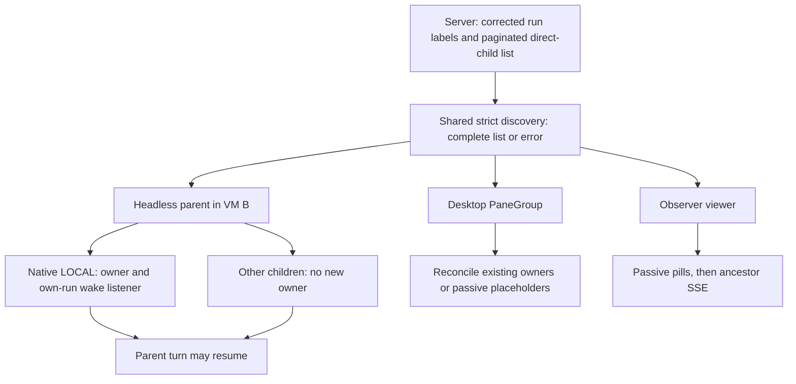
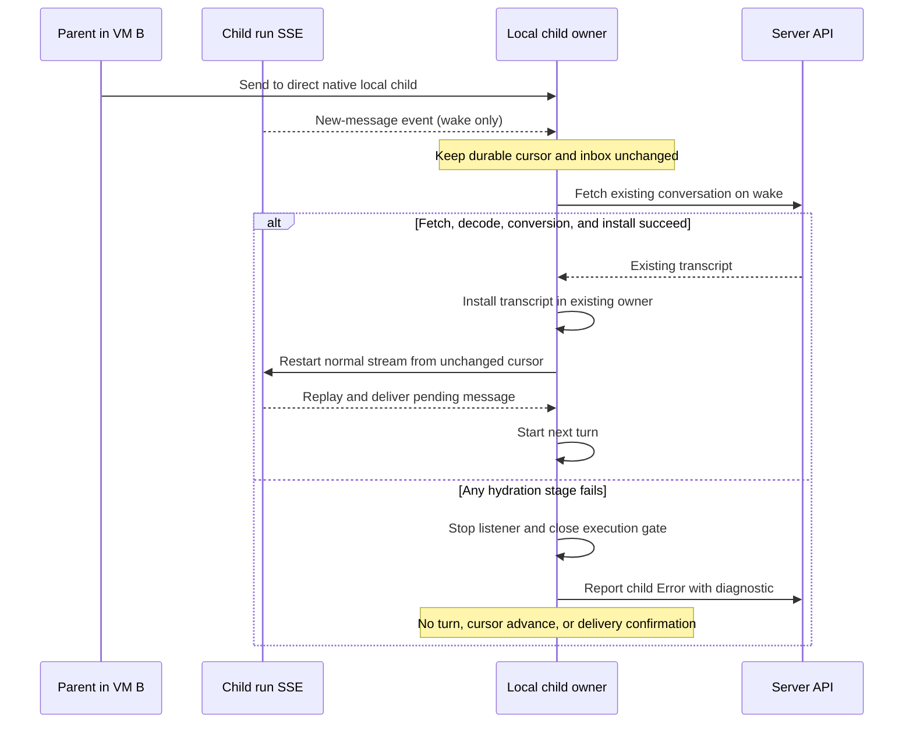

# Restore local child owners after cloud-parent VM handoff

## Summary
[QUALITY-2186](https://linear.app/warpdotdev/issue/QUALITY-2186/restore-local-child-owners-after-cloud-parent-vm-idle-destroyhandoff) affects a cloud parent that resumes after its VM is destroyed.
The new VM can show the parent's children, but it cannot receive messages for native (Oz) children that ran locally in the old VM.
Restore each child's **owner** in the new parent process before the parent can send it a message.
Subscribe to the child's events immediately; load its full conversation only on its first message or pane open.
Implementation and validation follow this contract.

## Handoff contract
1. Child restoration inherits the parent's existing handoff and workload-credential safeguards. Do not require an additional physical-VM-destruction barrier or introduce child-specific fencing; predecessor teardown may still be in progress.
2. VM B restores the parent's conversation and environment. It discovers **all direct children** through one complete, paginated server traversal.
3. VM B creates one lightweight owner for each native/Oz child classified `LOCAL`. The parent may resume only after each eligible child is listening or explicitly in `Error`. Owner-setup failure affects that child, not the parent's ability to recover. Remote and non-Oz children do not get new owners here.
4. When the parent sends to a local child, that child's event wakes its owner. The owner loads the existing transcript, then replays and delivers the message. Failed hydration puts that child in `Error` without executing a turn.
5. Desktop viewers and the Observer show passive child representations. Viewing a cloud parent's child never makes the desktop the child's owner.

### Terms
- **Parent / child:** An orchestrator run and one of its direct child runs. `ancestor_run_id` lists direct children, not all descendants.
- **Local owner:** The in-process child conversation, hidden terminal pane, controller, and event consumer that can execute a native child's turn and acknowledge its inbox. `LOCAL` is a persisted worker classification, **not** proof that an owner is alive.
- **Viewer / placeholder:** A read-only representation for the pill bar or transcript. It cannot consume or confirm the child's inbox. A cloud-owned parent shown on a desktop has viewers, not local child owners on that desktop.
- **Seed / discovery:** The initial server list of direct children. One shared helper traverses the pages. Headless restoration, desktop `PaneGroup`, and the Observer each decide what to do with the result.
- **SSE / cursor:** Server-Sent Events notify a process about run events. A cursor is the last sequence already processed or acknowledged. The parent's ancestor stream does **not** deliver a child's inbox; the child needs its own run stream.
- **Hydration:** Fetch and install the child's existing conversation transcript into its lightweight owner before it can execute another turn.

### Who uses the shared discovery result?

The diagram shows a shared **algorithm**, not one shared cache or process. The three consumers retain separate readiness gates, retries, and lifetimes.

## Design
### 1. Make the server's location label consistent
**Why:** Today the `LOCAL` filter uses the task's stored worker, but the response uses the active execution's worker. An ended local child can therefore pass the `LOCAL` filter and still say `REMOTE`. Its task source can also be `ORCHESTRATION`; source does not determine ownership.

- Derive the existing public response `execution_location` from persisted `run.Task.WorkerID` in `warp-server/router/handlers/public_api/run_execution_location.go:41-67`. `local` is `LOCAL`; a nonlocal, empty, or `NULL` worker is `REMOTE`.
- Keep the `LOCAL` SQL filter on `ai_tasks.worker_id=local`. Use `worker_id IS DISTINCT FROM 'local'` for `REMOTE`, including SQL `NULL`.
- Keep session-link eligibility separate from the corrected label. In `warp-server/router/handlers/public_api/agent_webhooks.go:2672-2722`, preserve the old active-local-execution exemption and the existing retained-session and GCS-transcript rules. An ended local task with no live execution must not gain a stale `session_id` or `session_link` to VM A.
- Describe the public field as a **persisted run-worker classification**, not evidence of a live execution. This correction changes location/environment labels, cloud platform and timeline display in Oz/Factory web Runs, desktop conversation-card icons, and CLI JSON. Preserve source-based rerun eligibility and the separate server cancellability flag.
- Deploy the corrected server first. Gate client ownership discovery with a rollout flag that remains off in an environment until its server deployment is confirmed. An older server can return a syntactically valid but wrong `REMOTE`; the client cannot detect this from the field. Once the flag is on, a missing `execution_location` is an error, not a remote child.

### 2. Discover direct children completely
**Why:** The existing GUI and Observer seeds stop at 100 results. The current `AIClient::list_ambient_agent_tasks` also drops `page_info` and silently skips malformed rows. Partial discovery can leave a local child's inbox without an owner.

- Add a **strict, page-returning** `AIClient` method in `app/src/server/server_api/ai.rs`. Return `runs`, `page_info.has_next_page`, and `page_info.next_cursor`. Keep the existing lenient `Vec<AmbientAgentTask>` method for unrelated callers.
- Implement one asynchronous `discover_direct_children(ai_client, parent_task_id)` helper. All three consumers below call it. Request `ancestor_run_id=parent_task_id` **without** an execution-location filter, sorted by `created_at asc`, up to 100 rows per page. Follow cursors until `has_next_page=false`.
- Fail the entire traversal if a required next cursor is missing, empty, or repeated; a run row cannot decode; its `execution_location` is missing; its `parent_run_id` differs from the requested parent; or repeated data for the same run ID conflicts on parent, location, or harness. Ignore an accidental parent row. Deduplicate identical run IDs in first-seen order.
- Return either the full traversal or an error. No consumer acts on a partial result. Pagination is **not an atomic snapshot**: another child can appear while pages are read. Do not add a global seed cache.

### 3. Restore owners in the resumed headless parent
**Why:** The headless `AgentDriver` restores its own conversation and event consumer, but it does not currently list children. The server does not wake a local run on its behalf.

- After the parent's conversation and environment exist, await the shared discovery before the first resumed turn **or** `--skip-initial-turn` completion. Retry transient list failures before releasing the parent. A permanent or persistently incomplete traversal is a parent setup error; do not start its turn.
- Create owners only for `LOCAL` native/Oz children. An absent harness defaults to Oz as in the existing task bootstrap. An unknown or explicitly non-Oz harness never becomes a native owner. Remote and non-Oz rows remain passive observations.
- Reuse each child's existing run ID, server conversation token, parent conversation ID, title, harness, and the parent's restored working directory. A missing usable token enters the child Error path; never create a replacement server run or transcript.
- `TerminalDriver::create` already opens a root workspace with a `PaneGroup`. Retain that group's handle for `AgentDriver`; find the parent pane by terminal-view ID. In the group's `ViewContext`, create a metadata-only **owner** conversation indexed by the child's existing run ID and bound to its existing token. Restore it through `PaneGroup::create_hidden_child_agent_pane`. The child gets a separate controller, terminal surface, and own-run event consumer. A hidden shell in the same workspace is allowed; another VM or workspace is not.
- Keep a run-ID-to-owner map and reconcile it with the history model's run-ID index. Repeated seeds, SSE reconnects, and restoration must not create a second owner, pane, or consumer. If a passive placeholder raced ahead of the owner, replace or promote it without losing the run-ID mapping. A placeholder must not suppress owner creation.
- If an individual pane, controller, or shell cannot be initialized, mark that child `Error` locally and on the server, leave its execution gate closed, and allow the parent to continue and recover. Never silently skip an eligible child.

### 4. Keep desktop and Observer consumers passive
**Desktop `PaneGroup`:**
- Use the shared discovery in `spawn_ancestor_list_fetch_if_needed`. Keep its pending-parent map, in-flight dispatch token, task-resolution retries, five-second transient retry, terminal-surface check, and hidden-pane reconciliation.
- Preserve hidden child panes that a **locally owned** GUI parent already owns. When the desktop views a **cloud-owned** parent, every discovered child is a passive placeholder, even if its label says `LOCAL`. Never claim a child just because of that label.
- In the headless parent's own workspace, defer passive GUI seeding until its owner pass finishes; then keep its local owner mappings and add remote placeholders.

**Observer:**
- Use the same discovery in `OrchestrationEventStreamer::spawn_ancestor_seed_fetch`. Seed `known_children` as passive pills for both locations. Do not create owners or read child inboxes.
- Keep the refcounted viewer registry. Mark it seeded and open its `AncestorRunId { include_self: false }` SSE **only after** all pages succeed.
- On failure, retry on the existing next registration/reconnect; do not add a timer or accept partial pages. Use a generation guard so a late fetch from an unregistered viewer cannot seed a newer registration for the same parent.

**Observer cursor handoff:**
- Capture the viewer's locally persisted **already-processed** cursor before traversal. Start ancestor SSE from that cursor, not the maximum child `last_event_sequence` returned by the list.
- The latter is an acknowledged per-run cursor, not a pagination snapshot barrier; it can skip a child created during traversal. Deduplicate replayed child IDs against `known_children`, and make an event for a previously unseen child create a passive pill.
- Persist only events the Observer processes, locally; never push its cursor to the server. More historical replay is intentional. Traversal alone still cannot guarantee an atomic view of children created concurrently elsewhere.

### 5. Wake the child; load its history only when needed
**Why:** Normal event draining can advance a cursor or dispatch a stub marked `Success` before its history exists. A wake-only listener must not behave like normal delivery.

- Give each owner `Unhydrated → Hydrating → Ready | Error` state. Before `Ready`, its own `RunIds([child_run_id])` SSE is **wake-only**. The parent's ancestor SSE sees child lifecycle but cannot replace this listener.
- Seed the child's cursor from its durable acknowledged sequence at discovery, or zero if absent. Do not merge a newer server cursor while the child is unhydrated; bypass the existing `spawn_task_harness_fetch_if_needed` / `finish_restore_fetch` max-with-server path. A wake event must not fetch or enqueue message contents, advance or persist/ack a cursor, mark mail delivered, or start an LLM turn.
- On wake, stop the wake-only listener and hydrate. A pane open also triggers hydration without mail. Coalesce simultaneous wake/pane-open requests into one operation per run ID.
- Fetch the **existing** server conversation token through `get_ai_conversation`. Convert using `RestorationMode::Continue` and the lightweight owner's existing `AIConversationId`, not a new ID. Merge transcript and metadata into that owner. Preserve run ID, parent link, child role, and terminal surface. Only after installation, restart normal child SSE from the unchanged durable cursor; replay, fetch, enqueue, and deliver pending mail; then release the child's controller gate. Do not resume an interrupted in-memory turn. The persisted transcript is authoritative, and the next delivered message starts the next turn. The parent may send after metadata restoration; only child injection waits for full hydration.
- If fetch, decode, conversion, or installation fails, stop the child's wake listener and leave normal delivery blocked. Set **both** local conversation and server task to `Error` with child run ID and failed stage. Use `AIClient::update_agent_task`/status reporting or the smallest explicit equivalent if normal sync requires a turn. Do not execute a request, confirm delivery, or automatically retry the failed child. Surface an Error-reporting failure rather than claiming success. A later deliberate restoration can retry only by creating a new owner from durable state. Other children stay active.

## Boundaries and trade-offs
- **Parent-equivalent safety:** Reuse the parent's existing handoff and inherited-workload-credential safeguards. Physical VM teardown need not finish before restoration. The child uses the parent's restored files; do not add a new destruction barrier, child-specific fencing, child snapshots, or a second workspace.
- **Narrow message scope:** Only a *running parent* sending to its *direct native/Oz local child* is covered. No messages sent while the parent VM is absent, child-to-parent or external-to-child delivery, undelivered-inbox scan, periodic poll, or `read_at` change. The `read_at` timing fix is separate.
- **Metadata now, transcript later:** Eager full history would simplify the first message but slow handoff as histories grow. Metadata-only owners subscribe before the parent resumes and fetch only on wake/open.
- **Correct the field, not a new one:** A new ownership field would keep the old response's accidental live-execution meaning but increase contract and client rollout work. Correcting `execution_location` aligns response and filters; decouple session-link eligibility to avoid a stale join link.
- **One traversal, three lifecycles:** A global seed/cache could share in-flight work but conflate headless readiness, desktop retries, and Observer permissions/cursors. Share only strict page traversal.
- **Existing pane, not another terminal factory:** Headless `TerminalDriver` already has a `PaneGroup`. Its hidden child pane provides a separate controller and terminal without duplicating terminal lifecycle setup.
- **Replay, not max-child cursor:** Observer replay costs historical events. The max-child shortcut could silently lose concurrent child discovery; use local processed cursor and deduplication.
- **Wake and Error, not premature delivery or blank continuation:** Normal SSE before hydration can skip or execute mail with no context. Gate it; an unhydratable child enters Error rather than inventing a fresh conversation. Do not change the existing dormant-Claude wake bridge.
- **Other work:** Remote child execution, non-Oz local child harnesses, viewer redesign, desktop startup/transcript laziness ([APP-5876](https://linear.app/warpdotdev/issue/APP-5876)), new public fields/schema, and child VM creation are out of scope. The existing API correction and strict client decoder **are** in scope.

### Assumptions to verify
- A resumable native local child has a server conversation token and server transcript. Missing either is a child Error, not permission to start fresh.
- Parent environment restoration finishes before child owner creation; no child-specific workspace reconstruction is required.
- A failed or malformed list blocks parent execution; child transcript failure affects only that child after complete discovery.
- Server-first rollout is operationally confirmed per environment. The existing wire response cannot prove that an older server's valid `REMOTE` is correct.

## Validation criteria for implementation
Add Rust cases adjacent to `app/src/pane_group/child_agent/restoration.rs`, `app/src/ai/blocklist/orchestration_event_streamer.rs`, `app/src/server/server_api/ai.rs`, and `app/src/ai/agent_sdk/driver.rs`. Run named cases from `warp` with `cargo nextest run -p warp --lib -E 'test(restored_local_child_)'`; run `cargo check -p warp` and `cargo clippy -p warp --all-targets --tests -- -D warnings`. Run server checks from `warp-server` with `go test ./router/handlers/public_api ./test/integration/ambient_agents` and the integration database configured.

### API labels and rollout
- Extend `TestConvertTasksToItems_ExecutionLocation` (`warp-server/router/handlers/public_api/agent_webhooks_test.go:1945-2010`). An ended `worker_id=local` run with no active execution and `source=ORCHESTRATION` returns `LOCAL`; nonlocal and unset/NULL workers return `REMOTE`.
- Change the task-local/active-execution-remote mismatch assertion (`agent_webhooks_test.go:2153-2195`) to `LOCAL`. Add the reverse mismatch.
- In `warp-server/test/integration/ambient_agents/public_api_runs_test.go`, compare GET and paginated-list response/filter parity for both locations, including NULL workers. Test that a terminal local run gets no stale session link without active local execution or independently verified retained/GCS data. Preserve transcript link precedence and remote retained sessions.
- Test the client flag: before confirmed server deployment, the new owner path stays off. After activation, missing `execution_location` fails setup. A valid but wrong `REMOTE` from an older server cannot be detected from its response.

### Strict discovery
- `restored_local_child_discovery_pages` returns 101+ mixed-location children over multiple pages, a repeated run ID, and a child created while paging. Assert `created_at asc`, a complete deduplicated result, and no partial application.
- Reject malformed rows, missing locations, wrong parents, conflicting duplicate parent/location/harness, and missing, empty, or repeated next cursors.

### VM A → B
- `restored_local_child_vm_a_to_b` restores the parent and child in B, then sends parent-to-child mail. Preserve the existing parent handoff and inherited-credential fencing checks; physical teardown of A may still be in progress.
- The run ID, server conversation token, parent link, working directory, and B-local conversation ID survive hydration. Assert one owner and own-run SSE before send, zero early transcript fetches, and one message turn.

### Headless and desktop ownership
- `restored_local_child_pagination_and_idempotence` pauses after page one. The parent cannot run or complete `--skip-initial-turn` before the last page and own-run listeners. Transient list failure retries; incomplete listing fails closed.
- Re-seed: assert one hidden owner pane, controller, and SSE per eligible child in the existing `PaneGroup`. Assert no fabricated server run, VM, second workspace, or transcript. Race a passive placeholder with restoration: keep one run-ID mapping and promote it to an owner.
- The desktop retains stale-result rejection, retries, and locally owned hidden panes. A desktop viewing a cloud parent keeps every child passive even when labeled `LOCAL`.
- `restored_local_child_classification` covers native local, remote, non-Oz local, unknown harness, and ended native local with corrected `LOCAL`. Only eligible native children get owners.

### Observer
- `restored_local_child_observer_seed` pauses after page one: no seeded flag or SSE before completion. After success, every location yields passive pills with no owner or inbox drain.
- Insert a child during paging that is absent from the result. Replay from the pre-traversal processed cursor must find it. Duplicate lifecycle events yield one pill and advance only the local cursor.
- Unregister and re-register during fetch: the stale completion must not seed the new viewer. Page failure opens no SSE and retries only on registration/reconnect.

### Public consumers
- Test ended-local location, environment, platform, and timeline in Oz and Factory web Runs with `yarn workspace @warp/agents test --run` and `yarn workspace @warp/factory test --run` from `warp-server/client`.
- Test desktop card classification with `cargo nextest run -p warp --lib -E 'test(test_task_entry_preserves_execution_location_independently_of_task_backing) or test(agent_icon)'`. `LOCAL` no longer gets cloud-run treatment; source-based rerun and server cancellability stay independent.

### Child wake, races, and failure
- `restored_local_child_hydration_gate` delays transcript load while two SSE wakes and a pane open arrive. Assert one load, no cursor/delivery advance or child request before hydration, then one replay and one turn. Re-seed and reconnect without duplicates.
- `restored_local_child_transcript_error` fails fetch, decode, and conversion separately. Assert local and server Error, no child request or delivery confirmation, and other children still owned. A failed Error update must be visible.
- Owner-setup failure marks only that child Error, leaves its execution gate closed, and allows the parent to recover after complete discovery.

## Implementation map
- Headless bootstrap and owner lifecycle: [`app/src/ai/agent_sdk/driver.rs:1102-1410`](https://github.com/warpdotdev/warp/blob/1e1acb4d74b3f55155860a785152bd23a2f3d83b/app/src/ai/agent_sdk/driver.rs#L1102-L1410), [`app/src/ai/agent_sdk/driver.rs:3441-3590`](https://github.com/warpdotdev/warp/blob/1e1acb4d74b3f55155860a785152bd23a2f3d83b/app/src/ai/agent_sdk/driver.rs#L3441-L3590), [`app/src/ai/agent_sdk/driver/terminal.rs:214-265`](https://github.com/warpdotdev/warp/blob/1e1acb4d74b3f55155860a785152bd23a2f3d83b/app/src/ai/agent_sdk/driver/terminal.rs#L214-L265), [`app/src/pane_group/mod.rs:2216-2229`](https://github.com/warpdotdev/warp/blob/1e1acb4d74b3f55155860a785152bd23a2f3d83b/app/src/pane_group/mod.rs#L2216-L2229).
- Hidden child owner, desktop seed, and passive viewer: [`app/src/pane_group/child_agent/restoration.rs:58-573`](https://github.com/warpdotdev/warp/blob/1e1acb4d74b3f55155860a785152bd23a2f3d83b/app/src/pane_group/child_agent/restoration.rs#L58-L573), [`app/src/pane_group/child_agent/hydration.rs:479-532`](https://github.com/warpdotdev/warp/blob/1e1acb4d74b3f55155860a785152bd23a2f3d83b/app/src/pane_group/child_agent/hydration.rs#L479-L532).
- Shared list decoder and direct-child REST response: [`app/src/server/server_api/ai.rs:808-1028`](https://github.com/warpdotdev/warp/blob/1e1acb4d74b3f55155860a785152bd23a2f3d83b/app/src/server/server_api/ai.rs#L808-L1028), [`app/src/server/server_api/ai.rs:2664-2675`](https://github.com/warpdotdev/warp/blob/1e1acb4d74b3f55155860a785152bd23a2f3d83b/app/src/server/server_api/ai.rs#L2664-L2675), [`warp-server/router/handlers/public_api/agent_webhooks.go:3075-3091`](https://github.com/warpdotdev/warp-server/blob/ae583264f4a28e1f1f172eea278a6112f8e28006/router/handlers/public_api/agent_webhooks.go#L3075-L3091), [`warp-server/model/ai_tasks.go:3066-3070`](https://github.com/warpdotdev/warp-server/blob/ae583264f4a28e1f1f172eea278a6112f8e28006/model/ai_tasks.go#L3066-L3070).
- Streamer, observer seed, and cursor behavior: [`app/src/ai/blocklist/orchestration_event_streamer.rs:1197-1428`](https://github.com/warpdotdev/warp/blob/1e1acb4d74b3f55155860a785152bd23a2f3d83b/app/src/ai/blocklist/orchestration_event_streamer.rs#L1197-L1428), [`app/src/ai/blocklist/orchestration_event_streamer.rs:1648-1695`](https://github.com/warpdotdev/warp/blob/1e1acb4d74b3f55155860a785152bd23a2f3d83b/app/src/ai/blocklist/orchestration_event_streamer.rs#L1648-L1695), [`app/src/ai/blocklist/orchestration_event_streamer.rs:1901-2211`](https://github.com/warpdotdev/warp/blob/1e1acb4d74b3f55155860a785152bd23a2f3d83b/app/src/ai/blocklist/orchestration_event_streamer.rs#L1901-L2211), [`app/src/ai/blocklist/orchestration_event_streamer.rs:2544-2620`](https://github.com/warpdotdev/warp/blob/1e1acb4d74b3f55155860a785152bd23a2f3d83b/app/src/ai/blocklist/orchestration_event_streamer.rs#L2544-L2620), [`app/src/ai/blocklist/controller.rs:2181-2255`](https://github.com/warpdotdev/warp/blob/1e1acb4d74b3f55155860a785152bd23a2f3d83b/app/src/ai/blocklist/controller.rs#L2181-L2255).
- Server labels/session links and client consequences: [`warp-server/router/handlers/public_api/run_execution_location.go:41-67`](https://github.com/warpdotdev/warp-server/blob/ae583264f4a28e1f1f172eea278a6112f8e28006/router/handlers/public_api/run_execution_location.go#L41-L67), [`warp-server/router/handlers/public_api/agent_webhooks.go:2672-2722`](https://github.com/warpdotdev/warp-server/blob/ae583264f4a28e1f1f172eea278a6112f8e28006/router/handlers/public_api/agent_webhooks.go#L2672-L2722), [`warp-server/logic/ai/ambient_agents/add_task.go:1234-1320`](https://github.com/warpdotdev/warp-server/blob/ae583264f4a28e1f1f172eea278a6112f8e28006/logic/ai/ambient_agents/add_task.go#L1234-L1320), `warp-server/client/packages/agents/src/pages/Runs/{util.tsx,run-platform.ts,RunDetailPane.tsx}` and Factory equivalents, `app/src/ai/agent_conversations_model/entry.rs:175-185`, `app/src/ui_components/agent_icon.rs:102-110`.
- Existing Oz resume/transcript and default harness: [`app/src/ai/agent_sdk/mod.rs:1858-1873`](https://github.com/warpdotdev/warp/blob/1e1acb4d74b3f55155860a785152bd23a2f3d83b/app/src/ai/agent_sdk/mod.rs#L1858-L1873), [`app/src/ai/agent_sdk/mod.rs:1957-2016`](https://github.com/warpdotdev/warp/blob/1e1acb4d74b3f55155860a785152bd23a2f3d83b/app/src/ai/agent_sdk/mod.rs#L1957-L2016), [`app/src/server/server_api/ai.rs:2751-2799`](https://github.com/warpdotdev/warp/blob/1e1acb4d74b3f55155860a785152bd23a2f3d83b/app/src/server/server_api/ai.rs#L2751-L2799), [`warp-server/logic/ai/ambient_agents/wake_driver.go:15-79`](https://github.com/warpdotdev/warp-server/blob/ae583264f4a28e1f1f172eea278a6112f8e28006/logic/ai/ambient_agents/wake_driver.go#L15-L79).
