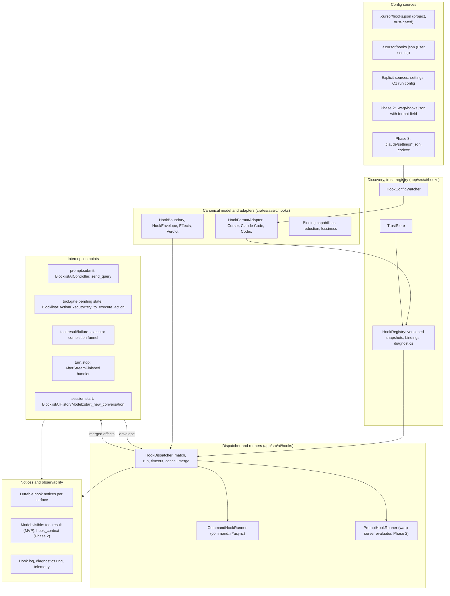

# Agent hooks in Warp: architecture proposal

Status: proposal for engineering review. Baseline: `warp` at `393e97a30a5ed85cf062b75e88326f83746dbecb` (master), vendor documentation read on 2026-10-19. Code paths are relative to the repository root and are cited as path plus symbol; line numbers drift and are not used. Supporting material: `cursor-hooks-coverage.md` (per-hook coverage verdicts), `research/01-cursor-hooks-catalog.md`, `research/02-claude-code-and-codex-hooks.md`, `research/03-warp-agent-loop-map.md`, and `research/04-warp-config-process-infra.md`.

## 1. Summary and recommendation

Agent hooks let a user or team run their own scripts, and later model-evaluated prompts, at fixed points in Warp's agent loop: before and after tool calls, when a prompt is submitted, when a turn ends, and at session boundaries. A command hook receives one JSON object on stdin and may return one JSON object on stdout to observe, deny, require confirmation, annotate, or (later) rewrite what the agent does. Prompt hooks evaluate the equivalent payload through a server API. Cursor's `hooks.json` is the first supported format. Claude Code and Codex formats follow as additional adapters.

The recommendation is a layered system with one canonical model in the middle. Format adapters parse vendor configs, encode Warp's canonical envelope into each vendor's wire shape, and decode vendor output into typed effects. Each binding (a Warp boundary, a vendor event, and an adapter) declares which effects it may produce and how it fails, and those declarations are validated when the source is activated. The loop and the process runner never see vendor vocabulary. Hooks gate tool calls at dispatch time inside the existing executor, so they judge the operation that will actually run. Permissions are tightening-only in the first release; a bounded, AgentDecides-only form of loosening comes in the second. Project-supplied hooks never run without an explicit trust decision, and location never grants permission to execute code. Warp follows documented vendor defaults where known and labels its choices where the docs are silent or conflict, with one "strict hook policy" setting for uniform fail-closed gates.

Delivery is three phases, with tentative estimates. Phase 1 (about 5 to 6 client weeks) ships the canonical model, the Cursor adapter, discovery and trust, the runner, dispatch-time gating without rewrites, tool, stop, prompt, and session-start events, and tightening-only composition. Its denial-reason wire support must be verified before calling it client-only (§9.3). Phase 2 (about 8 to 10 client weeks plus 2 to 3 server weeks, with the server estimate unvalidated) supports 18 of Cursor's 21 event names within the limits in §10. It adds rewrites under an explicit two-pass contract, bounded loosening, a Warp-owned file, model-visible context fields, and prompt hooks. `afterAgentResponse` ships on a client-side heuristic: a text message is treated as final when the next message starts or the stream ends; a server finality signal could make this exact later. Phase 3 adds Claude Code and Codex adapters at a tentative 3 to 4 weeks each. Cursor's two Tab hooks and `workspaceOpen` are excluded because Warp has no inline-completion surface and no project-open event (`cursor-hooks-coverage.md` §3.19 to §3.21).

## 2. Goals, non-goals, principles

**Goals.** Run existing Cursor command hooks with documented compatibility limits. Support every surface that runs the native loop: the GUI, the TUI, Oz cloud runs, and native orchestration children. Admit new formats and prompt hooks without changing the loop or the runner. Make denials, failures, unsupported features, and configuration provenance visible. Keep Warp's safety floors independent of hooks. Ship behind one feature flag with deterministic, testable decisions.

**Non-goals.** Hooks inside external harnesses (Claude Code or Codex running in Warp): those harnesses own their tools and hooks, and `ConversationDriver::executes_tool_calls_locally` (`app/src/ai/agent/conversation_driver.rs`) is false for them. Sandboxing hook processes or claiming a data-loss-prevention boundary. Reproducing every Claude Code lifecycle event. Guaranteeing cleanup after crashes or exactly-once external side effects. Authoring hooks into third-party agents, which is the existing CLI-agent plugin system (`research/04-warp-config-process-infra.md` §7).

**Principles.**

1. One canonical model; vendor vocabulary stays inside adapters.
2. Separate configuration location, format, execution host, and authority. A Cursor-shaped file may live anywhere, and where it lives never grants permission to execute it.
3. Decisions are typed and merged deterministically by source priority and array order, never by completion time.
4. Vendor-faithful defaults; a single strict override. Strict mode is a Warp policy, not format parity.
5. Hooks can tighten from any source. Loosening is a separately granted capability and never crosses Warp's floors.
6. An unsupported control effect on a gate denies. Silently dropping a rewrite or a denial is the one failure that must not happen.
7. The decision must describe the operation that will run: final arguments, current cwd, current configuration revision.
8. Reuse infrastructure, not incidental semantics: the MCP watcher's discovery loop is reusable; its no-prompt trust posture is not.

## 3. Layered architecture

**Placement.** Pure data, parsing, matcher compilation, encoding and decoding, capability declarations, and reduction live in `crates/ai/src/hooks/`. That crate is wasm-safe and already depends on `serde_json` and `regex`. Everything that watches files, spawns processes, talks to the server, or touches sessions and UI lives in `app/src/ai/hooks/`, gated on native targets with explicit unavailable stubs for wasm. No new crate: nothing below `app` needs the runner, and both `warp_tui` and the Oz binary consume `app` (`research/04-warp-config-process-infra.md` §4).

**Components.**

- **Canonical model** (`crates/ai/src/hooks/model.rs`). Boundaries, envelope, effects, five-valued verdict, reduction rules. Reuses `AIAgentActionType` and `AIAgentActionResultType` (`crates/ai/src/agent/action/mod.rs`, `action_result/mod.rs`) for tool identity and payload encoding.
- **Format adapters** (`crates/ai/src/hooks/adapters/`). A static registry of known formats, modeled on `SKILL_PROVIDER_DEFINITIONS` (`crates/ai/src/skills/skill_provider.rs`) and `MCPProvider` (`app/src/ai/mcp/mod.rs`). Each implements parse, binding declaration, matcher evaluation, input encoding, and output decoding.
- **HookConfigWatcher** (`app/src/ai/hooks/watcher.rs`). Finds and watches sources at `[home, repo_root]` per format, re-parses on change with generation tags, publishes revisions and diagnostics. Modeled on `FileMCPWatcher`, `global_config_sources`, `PendingScan`, and `update_servers_from_config_file` (`app/src/ai/mcp/file_mcp_watcher.rs`). Roots come from `DetectedRepositories::get_root_for_path` (`crates/repo_metadata/src/repositories.rs`); home files use `HomeDirectoryWatcher`; cloud roots arrive through `register_cloned_repo` (`app/src/ai/agent_sdk/driver/environment.rs`).
- **TrustStore** (`app/src/ai/hooks/trust.rs`). Local approval records keyed as in §8, persisted outside the repository.
- **HookRegistry** (`app/src/ai/hooks/registry.rs`, a warpui model). Immutable, versioned snapshots of active bindings with provenance; answers "bindings for this boundary at this cwd and host"; keeps the last valid snapshot on malformed reload. Root resolution follows `FileBasedMCPManager::get_servers_for_working_directory` (`app/src/ai/mcp/file_based_manager.rs`).
- **HookDispatcher** (`app/src/ai/hooks/dispatch.rs`). The one call the loop makes: fire an envelope, get merged effects. Pins a snapshot per gate, runs matches concurrently under a bound, applies deadlines and cancellation, decodes through the adapter, reduces, logs, emits telemetry, routes notices.
- **CommandHookRunner** (`app/src/ai/hooks/runner/command.rs`). A dedicated one-shot JSON-over-stdio spawner on `command::r#async::Command` with a process group (`crates/command/src/async.rs`). It is not built on `CommandExecutor::execute_command` (`app/src/terminal/model/session/command_executor.rs`), which has no stdin parameter, nor on `LocalCommandExecutor::execute_local_command_internal`, which forces null stdin. It borrows PATH capture from `LocalShellState::get_interactive_path_env_var` (`app/src/terminal/local_shell/mod.rs`) and the timer, SIGTERM, grace, kill shutdown from `lsp::ProcessTransport` (`crates/lsp/src/transport.rs`).
- **PromptHookRunner** (`app/src/ai/hooks/runner/prompt.rs`, Phase 2). Calls a new warp-server evaluator through `ServerApi`, following the REST pattern of `/ai/generate_block_title` (`app/src/server/server_api/block.rs`).
- **Interception points** (existing files; §5). Build envelopes, await the dispatcher where the boundary blocks, apply effects.
- **Permission composition** (`BlocklistAIActionExecutor::try_to_execute_action`, `app/src/ai/blocklist/action_model/execute.rs`). Combines the cached hook verdict with `BlocklistAIPermissions` (`app/src/ai/blocklist/permissions.rs`) while preserving reasons, so "hook denied" stays distinct from "needs confirmation".
- **Notices** (`app/src/ai/hooks/notices.rs`). A `HookMessenger` trait with per-surface implementations: GUI cards and `AgentNotificationsModel` (`app/src/ai/agent_management/agent_management_model.rs`), TUI hints, Oz structured stdout via `AgentDriver::write_output` (`app/src/ai/agent_sdk/driver.rs`). Denials are durable notices attached to the action, not only toasts.
- **Observability** (`app/src/ai/hooks/{log,telemetry}.rs`). A bounded private hook log following the MCP stderr logger pattern (`crates/mcp/src/runtime.rs`); a per-conversation ring of invocation records; telemetry via `register_telemetry_event!` joined on `AIIdentifiers` (`app/src/ai/agent/telemetry.rs`), never carrying commands, prompts, file contents, or hook output.
- **Gates.** `FeatureFlag::AgentHooks` (`crates/warp_features/src/lib.rs`); a `define_settings_group!` group (`app/src/settings/ai.rs`) with palette toggle pairs for: hooks enabled, read Cursor user file, strict hook policy, default timeouts; Oz run configuration fields in `AgentConfigSnapshotFile` (`app/src/ai/agent_sdk/config_file.rs`).

## 4. Canonical model and adapters

### 4.1 Boundaries and vendor mapping

Boundaries are grounded in moments Warp's loop can supply. A new boundary is added only when Warp can provide its timing and honor at least one of its effects. Several vendor events project onto one boundary; the adapter's matcher and payload view distinguish them.

| Canonical boundary | Cursor | Claude Code | Codex | Phase |
| --- | --- | --- | --- | --- |
| `session.start` | `sessionStart` | `SessionStart` | `SessionStart` | 1 (observe) |
| `session.end` | `sessionEnd` | `SessionEnd` | `SessionEnd` | 2 |
| `prompt.submit` | `beforeSubmitPrompt` | `UserPromptSubmit` | `UserPromptSubmit` | 1 |
| `tool.gate` | `preToolUse`; shell and MCP facets `beforeShellExecution`, `beforeMCPExecution` | `PreToolUse` | `PreToolUse` | 1 |
| `tool.permission_request` | — | `PermissionRequest` | `PermissionRequest` | 3 |
| `tool.result` | `postToolUse`; facets `afterShellExecution`, `afterMCPExecution`, `afterFileEdit` | `PostToolUse` | `PostToolUse` | 1 (edit facet 2) |
| `tool.failure` | `postToolUseFailure` | `PostToolUseFailure` | — | 1 |
| `file.exposure` | `beforeReadFile` | — (reads use `PreToolUse`) | — | 2 |
| `subagent.start` | `subagentStart` | `SubagentStart` (context only) | `SubagentStart` (context only) | 2 |
| `subagent.stop` | `subagentStop` | `SubagentStop` | `SubagentStop` | 2 |
| `turn.stop` | `stop` | `Stop` | `Stop` | 1 |
| `turn.interrupt` | — | — | `Interrupt` | 3 |
| `compaction.pre` | `preCompact` (manual only) | `PreCompact` | `PreCompact` | 2 |
| `compaction.post` | — | `PostCompact` | `PostCompact` | 3 |
| `response.complete` | `afterAgentResponse` (client heuristic) | — | — | 2 |
| `reasoning.complete` | `afterAgentThought` | — | — | 2 |

Parsed, reported as unsupported, and never fired: Cursor `beforeTabFileRead`, `afterTabFileEdit`, `workspaceOpen`; Claude `Notification`, `PermissionDenied`, `PostToolBatch`, `StopFailure`, `UserPromptExpansion`, `MessageDisplay`, `Setup`, `InstructionsLoaded`, and the task, teammate, config, cwd, directory, file, worktree, model-switch, and elicitation events.

`file.exposure` is a distinct boundary rather than a facet of `tool.result`. Its timing is "content has been read locally but not yet shown to the model", and its failure semantics are those of a permission hook (`research/01-cursor-hooks-catalog.md` §2.2). It covers `ReadFiles` in Phase 2 and must later be extended to the other content paths (`SearchCodebase`, `get_files`, `ReadSkill`, project rules, passive relevant files) before Warp claims file-access control (`cursor-hooks-coverage.md` §3.12).

### 4.2 Envelope

Common fields, with missing values absent rather than fabricated:

- `schema_version`, `occurrence_id`, `invocation_id`.
- `conversation_id` (`AIConversationId`, which exists before the server token; `research/03-warp-agent-loop-map.md` §2).
- `turn_id`: a user-turn identifier allocated at the prompt gate and carried across every exchange of that turn. This is what Cursor's `generation_id` and Claude's `prompt_id` map to. `AIAgentExchangeId` changes per request, including tool-result follow-ups, so it is exposed separately as `exchange_id` (`AIConversation::turn_exchange_ids`, `app/src/ai/agent/conversation.rs`). `exchange_id` is optional because `session.start` precedes any exchange.
- `action_id` (`AIAgentActionId`) on tool boundaries; `run_id`, parent ids, and child correlation ids when available.
- `surface` (GUI, TUI, Oz run, local child), `execution_host`, `cwd`, `roots`, `source_revision`.
- Model metadata (`LLMId`), user email, Warp version, hook protocol version (precedent: `warp_core::cli_agent_protocol`).
- Permission facts: whether Warp's own check would ask, the active autonomy level, and the derived vendor `permission_mode` where an adapter needs it.

Per-boundary payloads use Warp's own types serialized to neutral JSON: the action and its arguments, cwd, timing, result or failure, and facets (shell adds command, execution state, sandbox flag, captured output; MCP adds stable server identity and transport metadata; file exposure adds host-qualified path, text or an explicit unsupported content kind, range, and revision; edits add path, old and new text, and saved outcome). The proto `risk_category` is dropped today in `From<RunShellCommand>` (`crates/ai/src/agent/action/convert.rs`); plumbing it is a small prerequisite so policy hooks can key on it.

### 4.3 Effects and verdicts

An effect bundle has independent channels: verdict with reason; replacement input; replacement model-visible result; model context; user notice; hook-session environment; halt turn; continuation request. Rewrites are whole validated objects, never partial mutations of app state.

The verdict is five-valued: no opinion, allow, deny, ask, defer. `Defer` is represented because Claude Code defines it, but resumable deferral is unsupported in Warp. Claude's reference says `defer` "exits gracefully so the tool can be resumed later", is honored only in non-interactive `-p` runs where the host process reads `stop_reason: "tool_deferred"` and later resumes, is restricted to a single pending tool call, ignores `updatedInput` and `additionalContext`, and in interactive sessions "logs a warning and ignores the hook result". Warp follows the interactive warning-and-ignore behavior. On headless surfaces it rejects the unsupported control effect with a specific diagnostic and does not execute the action; it does not claim to have suspended work for later resume. This is not an approval-unavailable result or an `ask` decision.

### 4.4 Per-binding capabilities

A binding is one boundary, one vendor event, and one adapter. It declares the effects that vendor event may produce (for example Cursor `preCompact` produces only a user notice; Claude `PreCompact` may halt), the failure semantics (fail-open or fail-closed, and how malformed or empty output is treated), the matcher target, and the handler kind. At activation the registry validates those capabilities against what the boundary can honor in the current phase and warns about gaps. It cannot predict an arbitrary script's output; the warning says that a rewrite, if emitted, will be rejected. At runtime, a control effect that the binding does not permit or the phase cannot honor denies on a gate and is reported on any other boundary. Vendor-defined ignored fields remain governed by the adapter's documented defaults. Capabilities therefore attach to the binding and the boundary, not only to the event enum.

### 4.5 Lossiness tables

Cursor adapter:

| Cursor feature | Warp behavior |
| --- | --- |
| `preToolUse` `ask` | Ignored by default, as Cursor documents; honored as `ask` in strict mode |
| `subagentStart` `ask` | Treated as deny, as Cursor documents |
| `updated_input` | Phase 1: a rewrite on a gate denies with a diagnostic. Phase 2: two-pass contract (§6.2) |
| `additional_context`; denial `agent_message` | Additional context is Phase 2 after `hook_context` protos exist (§9.3). Cursor's `agent_message` applies on denial; general denial-reason delivery is a Phase 1 wire-contract dependency |
| `beforeReadFile` | Fires after the local read, before model exposure; `ReadFiles` only in Phase 2; other content paths later |
| `preCompact` | Manual `/compact` only; automatic compaction is server-side and unsupported |
| `subagentStart`, `subagentStop` | Native children only, parent-side: start is an allow/deny gate; stop is observational. Server-side subagents and child `followup_message` are not advertised |
| `afterAgentResponse` | Phase 2 client heuristic: emit once per text message when the next message starts or the stream ends. Exact finality needs a later server signal. `afterAgentThought` uses reasoning `finished_duration` |
| `transcript_path` | `null`; Warp keeps transcripts in SQLite |
| `cursor_version`, `CURSOR_VERSION` | Format-driven labeled compatibility values, including from Warp-owned Cursor-format files; `warp_version` carries the real version |
| Scalar output merge | Highest-priority source wins; Cursor's pages disagree with each other (§7.4) |
| `loop_limit` | Per-definition count within one continuation chain plus a host cap of 8 |
| Tab hooks, `workspaceOpen` | Never fire |
| Prompt hooks | Phase 2, after the evaluator; documented shell example first |

Claude Code adapter (Phase 3):

| Claude feature | Warp behavior |
| --- | --- |
| Roughly two-thirds of events | Parsed, reported unsupported, never fire |
| `defer` | Represented; ignored interactively with a warning; headless resumable deferral is rejected as unsupported, not treated as `ask` |
| `PermissionRequest` | `tool.permission_request`; fires only when Warp would show a confirmation; its allow is the bounded-loosening path and needs the "may approve" grant |
| `updatedToolOutput` (any tool) | Honored where the Warp result has a replaceable payload; otherwise reported |
| `http`, `mcp_tool`, `agent` handlers; `asyncRewake`; `once`; `if` | Unsupported; `async` runs detached and observe-only |
| `terminalSequence`, `watchPaths`, `sessionTitle`, `initialUserMessage`, `suppressOriginalPrompt`, `CLAUDE_ENV_FILE` | Unsupported |
| Plain-text stdout as context | Honored only once `hook_context` exists |
| `transcript_path` | `null` although the SDK types mark it required |
| Exit code 2 per event | Honored per Claude's table where the event exists |
| Matcher dialect | Exact-name rule plus unanchored regex; JavaScript-only syntax rejected with a diagnostic |

Codex adapter (Phase 3):

| Codex feature | Warp behavior |
| --- | --- |
| `Interrupt` | `turn.interrupt`, observational |
| `PreToolUse` `ask` | Failed hook that proceeds, as Codex documents; honored in strict mode |
| `PermissionRequest` | As for Claude |
| `PostToolUse` `decision: "block"` | Replaces the model-visible result with the reason when the Codex adapter ships in Phase 3, using Phase 2 result-replacement support |
| `commandWindows`, `config.toml` `[hooks]` | Honored; TOML normalized as the MCP parser already does |
| `async`, `mcp_tool`, `prompt`, `agent` | `async` detached; `mcp_tool` unsupported; `prompt` and `agent` not run, matching Codex |
| `additionalContextLimit` | Ignored |
| Completion-order rewrite resolution | Not reproduced; deterministic order instead |

## 5. Interception points

| Canonical boundary | Warp seam | Blockable | Modifiable | Phase |
| --- | --- | --- | --- | --- |
| `session.start` | `BlocklistAIHistoryModel::start_new_conversation` (`app/src/ai/blocklist/history_model.rs`); barrier before first `send_request_input` | Barrier only; creation cannot be denied | Hook env; context in Phase 2 | 1 |
| `session.end` | Conversation delete, surface close; Oz `AgentDriver::cleanup` (awaited) | No | No | 2 |
| `prompt.submit` | `BlocklistAIController::send_query` (`app/src/ai/blocklist/controller.rs`), made async by spawn and continuation; allocates `turn_id` | Yes (halt) | Prompt rewrite has no vendor field | 1 |
| `tool.gate` | Pending-hook state in `BlocklistAIActionExecutor::try_to_execute_action` (§6.1) | Yes | Rewrites Phase 2 | 1 |
| `tool.permission_request` | Same seam, fired only when Warp's verdict is "ask" | Yes | Rewrites Phase 2 | 3 |
| `tool.result`, `tool.failure` | One completion funnel holding results before `BlocklistAIActionModel::handle_action_result` (`app/src/ai/blocklist/action_model.rs`), covering async futures, synchronous results, denials, and cancellations | Holds the result | Replacement output Phase 2 | 1 |
| `file.exposure` | `ReadFilesExecutor` completion (`app/src/ai/blocklist/action_model/execute/read_files.rs`) with content in a private buffer | Yes, per file | Range filtering | 2 |
| `subagent.start` | `RunAgentsExecutor::execute` before dispatch (`app/src/ai/blocklist/action_model/execute/run_agents.rs`) | Yes | Child context for later adapters | 2 |
| `subagent.stop` | `inject_pending_events_for_request` and the follow-up piggyback path in the controller | No | Follow-up not advertised | 2 |
| `turn.stop` | `AfterStreamFinished` handling in the controller, before `Success` is finalized | Hold finalization | Follow-up | 1 |
| `turn.interrupt` | `CancellationReason` paths | No | No | 3 |
| `compaction.pre` | `/compact` via `SlashCommandRequest::Summarize` | Manual only | No | 2 |
| `compaction.post` | Finished `Message::Summarization` | No | No | 3 |
| `response.complete` | Streaming text (`app/src/ai/agent/api/convert_from.rs:ConvertAPIMessageToClientOutputMessage::to_client_output_message`); next-message/stream-end heuristic | No | No | 2 |
| `reasoning.complete` | Same converter; reasoning `finished_duration` marks completion | No | No | 2 |

Tool calls are queued only after the whole response has streamed (`AfterStreamFinished` then `queue_actions`), so their gates run between model requests. Detached response and reasoning observers may run while the rest of the response is still streaming. They cannot inject into the in-flight model request or revise text already streamed into the proto history that is replayed to the server (`research/03-warp-agent-loop-map.md` §3.k).

## 6. Decision semantics and permission composition

### 6.1 Dispatch-time gate

The gate lives at dispatch so the hook sees the final operation. `BlocklistAIActionModel::queue_actions` preprocesses a whole batch before any action runs, so a queue-time gate would see the cwd and files as they were before earlier commands in the same batch executed, and `handle_requested_command_accepted` can change the command text after a queue-time decision. `try_to_execute_action` is synchronous today, so the gate needs a small state machine. This is the riskiest edit in the proposal.

- A cached verdict is keyed by action id, argument revision, cwd, and registry revision.
- Without a valid verdict, the action remains pending as "checking hooks" while the dispatcher evaluates it asynchronously. Several actions may wait during a parallel read-only phase.
- Completion resumes permission composition for the same operation: deny produces a denied result, ask requires confirmation, and allow or no opinion leaves Warp's own checks in place. Model-visible denial reasons must satisfy the wire contract in §9.3.
- User confirmation consults the same gate. A changed command, cwd, or registry invalidates the verdict. Approval satisfies a hook `ask` only for the exact approved revision and never bypasses hook `deny`.
- Cancellation kills pending hook processes and prevents execution. Disabling the feature cancels every pending invocation.

Costs: a denied action is briefly visible as pending; a rewritten file edit requires `preprocess_action` to run again and a second diff to be generated, and the user must see the final diff before approving.

### 6.2 Rewrites

Phase 1 does not support `updated_input`. On a gate, a rewrite the current phase cannot honor denies with a diagnostic; it is never dropped silently. Phase 2 adds rewrites under an explicit two-pass contract: apply the rewrite as a whole validated object; clear the model's risk flags (`is_read_only`, `is_risky`, and the newly carried `risk_category`), because they describe the old command and `BlocklistAIPermissions::can_autoexecute_command` can auto-allow based on `is_read_only` or `is_risky` under `AgentDecides`; recompute preprocessing and permissions; re-run the matching gate hooks on the final input; any deny survives; a second, different rewrite fails as unstable. There is no fixed-point loop. This is documented as Warp behavior: all matching gate hooks may run twice when any hook rewrites, and Cursor does not promise hook idempotence.

### 6.3 Merging across hooks and sources

All matching bindings run concurrently against the same immutable input. Results merge in a fixed order: source priority, then array index in the config. Verdicts merge by severity, deny over ask over allow over no opinion. Halt is any-wins. Notices and model context concatenate in merge order. Scalar fields (replacement input, replacement output, continuation) take the highest-priority value; conflicts are logged. Identical resolved sources (the same file reached through two paths) run once; identical command text in different sources is not deduplicated.

### 6.4 Failure policy, timeouts, strict mode

Defaults follow the adapter's documented semantics. For Cursor: exit 2 denies; other non-zero exits, crashes, and timeouts fail open unless `failClosed`; malformed non-empty output fails closed on Cursor's six permission hooks (`beforeShellExecution`, `beforeMCPExecution`, `beforeReadFile`, `beforeTabFileRead`, `subagentStart`, `preToolUse`) even without `failClosed`; empty stdout is a no-output failure governed by `failClosed`; malformed output on `beforeSubmitPrompt` follows `failClosed` because Cursor's rule is unstated. Observers report failures and continue. Post-result failures preserve the original result. A failed `session.start` adds no context or environment. A failed stop hook does not continue the turn. Cancellation never becomes fail-open execution.

One setting, "strict hook policy", turns every gate evaluation failure, including timeout, crash, malformed output, and unsupported control output, into denial. It also honors schema-accepted `ask` values that the vendor would otherwise ignore or treat as a failed-open hook. It never weakens a vendor denial into an ask, so Cursor `subagentStart.ask` still denies. It is a Warp policy for security deployments and is not described as format parity.

Proposed default timeouts, flagged as a judgment call because Cursor publishes none: 30 seconds for gate boundaries, 60 seconds for post-tool and other boundaries, 5 seconds for `session.end`. All are configurable per definition; values above an activation-policy ceiling are rejected rather than truncated.

The Cursor adapter uses Rust `regex`, unanchored and case-sensitive; `""` and `"*"` match everything. Later adapters retain their exact-name and event-specific matching rules before compiling regex patterns. A matcher that fails to compile invalidates that definition. On hot reload of a file that was valid, the registry keeps the last valid snapshot active, marks it stale, and shows a diagnostic. On first activation, a source with errors stays inactive with an error.

### 6.5 Composition with Warp's permissions

Warp's verdict today is a bool from `should_autoexecute`, consumed in `try_to_execute_action` together with `is_user_initiated` and the autonomous shell exception. The hook verdict composes before the dispatch side effect and preserves reasons.

Options:

- **Tighten-only forever.** Hook `allow` means "no objection". Simple and safe, but it breaks the documented meaning of `allow` for Claude hooks (which skip the default prompt) and makes policy automation impossible. Rejected as a permanent position; adopted for Phase 1.
- **Hooks decide first.** Hook `allow` auto-approves anything. Repository code could defeat user settings. Rejected.
- **Bounded loosening (recommended for Phase 2).** Hook `allow` may satisfy only the confirmation Warp would show under `ActionPermission::AgentDecides`. It never applies under `AlwaysAsk`, never crosses the organization or user denylists or protected write paths, and is available only to sources granted a separate "may approve" capability in the trust UI, distinct from trust-to-run; project sources need that grant explicitly. Claude Code's reference also preserves deny and ask rules despite hook approval, but Warp's AgentDecides-only restriction is its own narrower policy, not an exact mapping of Claude permission modes.

A qualification from the code: Warp's floors are not one uniform layer. `can_autoexecute_command` evaluates organization deny rules first but permits a setting to bypass the user denylist; `can_write_files` checks protected paths only outside sandbox mode; `can_use_mcp_server` returns early under auto-approve; and `is_user_initiated` bypasses a false autoexecute verdict entirely. Defining the floors that hook approval never crosses is new policy plumbing, and it must not silently turn existing user-confirmable restrictions into absolute prohibitions.

Headless surfaces (Oz runs, hidden local children) have no approver. Hook `ask` degrades to deny with an "approval unavailable" reason, so the model can adapt instead of the run failing as `ConversationBlocked`. The reason is always recorded in the durable notice and structured output; delivering it to the model for every tool is a Phase 1 release dependency (§9.3). Claude's reference documents model-visible denial reasons for `-p` runs, but Warp still needs the wire support to provide them. A run flag can select the stricter fail-the-run behavior.

## 7. Config sources and precedence

### 7.1 Options

- **Cursor's own files only.** Lowest friction and the strongest compatibility expectation. Costs: scripts may assume Cursor's environment; a user's `~/.cursor/hooks.json` expresses intent about Cursor; when both products are used on one repo, both run the same formatters and notifications for their own sessions, and precedence cannot undo scripts that already ran.
- **A Warp-owned Cursor-schema file only.** Clear execution ownership and no cross-host surprise. Costs: no reuse without copying, and pressure to make a temporary schema choice Warp's permanent format.
- **Both.** Flexible, but duplicated definitions can run twice and users must understand that a lower-priority file still executes.

### 7.2 Recommendation

Phase 1 reads Cursor's own files, opt-in: project `<root>/.cursor/hooks.json` behind the trust gate (§8), and user `~/.cursor/hooks.json` behind an explicit setting. On interactive surfaces, a first-run discovery prompt explains a newly found inactive file and how to enable it. Unattended runs emit a diagnostic rather than wait for a discovery prompt. Phase 1 also accepts explicit sources described by path, format, and scope in settings and in the Oz run configuration, which is how cloud runs and Warp-only Cursor-schema files are expressed before a Warp file exists.

Phase 2 adds a Warp-owned project and user file, `.warp/hooks.json`, with a mandatory `format` discriminator so Warp's namespace is not bound to Cursor's schema. Warp extensions live under Warp's own format value, not under Cursor's `version: 1`. Claude Code and Codex files slot in later as additional sources after native ones.

### 7.3 Resolution rules

Project hooks resolve against the detected git root, not every ancestor directory; non-git folders need an explicitly selected root. Relative commands resolve against the project root for project files (as Cursor documents) and against the config file's directory for user files (`~/.cursor` for Cursor's user file). Scope follows the active operation's host and root; the cloud behavior of treating every known directory as in scope is not copied from skills. A pinned required run policy stays active when cwd changes.

### 7.4 Precedence

Highest first: managed or team (future) → Warp project file → Cursor project file → Warp user file → Cursor user file → Claude project-local, Claude project, Claude user → Codex project, Codex user. Precedence affects scalar fields and tie-breaks only; verdict severity ignores it. Scalar fields take the highest-priority value. Cursor's main page says the opposite ("last response wins", so a lower-priority source can override) and its third-party page says higher priority wins; Warp's choice is published as a compatibility note. Lower-priority scripts still run, and precedence cannot undo their side effects.

## 8. Trust and activation

Location never grants permission to execute code. Reading project rules, skills, or MCP configs from a repository is not consent to run its scripts. No reusable native-agent workspace execution-trust mechanism was found in the inspected `app/src` and `crates/ai` code; the relevant trust writes configure third-party harnesses (`app/src/ai/agent_sdk/driver/harness/codex.rs:prepare_codex_config_toml`). Processes Warp spawns for itself have no separate sandbox in the inspected paths (`research/04-warp-config-process-infra.md` §3.5).

**Interactive surfaces.** A project source is inert until the user approves it in a review card listing each event, matcher, and command or prompt, with the data each boundary exposes and the execution host. The approval is keyed by repository root, execution host, resolved source identity (so symlinks, worktrees, and SSH hosts are distinct), and configuration revision. Any configuration change requires re-approval and shows a diff. Warp records changes to scripts the configuration directly names where it can resolve them, without claiming to track arbitrary shell dependencies. Approvals are local and never synced. A separate "may approve" grant (§6.5) is never implied by trust-to-run.

**Headless and Oz runs.** No automatic trust. Project hooks activate only through an environment- or team-level setting (the mainstream path) or an explicit run flag or manifest entry in `AgentConfigSnapshotFile` (the override), and the activated set is pinned at run start. A hook set discovered in the checkout but not activated produces a visible diagnostic. "The agent could have run that script anyway" is not consent: hooks give repository code guaranteed execution on every tool call with full payload access, before any model decision.

**Protect hook source files.** Hook configuration files and the scripts they name become protected write paths in `can_write_files`, next to the MCP config paths already checked there (`app/src/ai/blocklist/permissions.rs:check_protected_write_paths`). The hook-specific guard must cover sandboxed runs and cannot be bypassed by hook approval. Untrusted replacement definitions never activate automatically. A malformed config leaves the last valid approved definition snapshot in place, but a changed, untrusted script is not executed from that snapshot. Required sources block with a clear error until re-approved interactively or a new activated revision is selected at a later run start. This is an agent file-edit guard, not operating-system write protection: shell commands and indirect scripts can still alter files. Required enforcement sources should be outside the writable checkout or made read-only by the environment.

**Children.** Personal hooks are not silently inherited. Local children share the parent's process and registry and run under the parent's approved project set (`inherit_child_agent_settings`, `app/src/ai/blocklist/child_agent_launch.rs`, copies profile and model only, not files). Remote children receive an explicit effective source set through remote launch plumbing (`prepare_remote_child_launch`, `app/src/ai/orchestration/remote_child.rs`), which has no hook fields today. Passing a hook set does not move scripts, dependencies, or an approved execution host to another machine; the child's environment must already contain them, and a missing required source blocks launch.

## 9. Execution model

### 9.1 Command hooks

A dedicated one-shot runner spawns each hook through `command::r#async::Command` with a process group, outside the interactive PTY. It writes one bounded JSON object to stdin and closes it, drains stdout and stderr concurrently, and parses only after exit. Payload bytes are never interpolated into shell source. Command strings run under the declared host shell; direct argv execution is kept available internally for future Claude `args` handlers. Runner activity never emits tool hooks recursively. Side-effecting hooks are not retried automatically; late output after cancellation is discarded.

Working directory: project root for project sources, the config file's directory for user sources, declared metadata for explicit sources. Start with the runner host's environment under a documented scrub policy, HOME, the captured login-shell PATH, and the hook-session environment. Then set protected host and protocol identity fields: `WARP_PROJECT_DIR`, `WARP_VERSION`, `WARP_HOOK_PROTOCOL_VERSION`, and `WARP_RUN_ID` when a run id exists. Vendor aliases are selected by the source's **format**, not its path: every Cursor-format source, including an explicit source or a Warp-owned file with `format: cursor`, receives the `CURSOR_*` aliases and labeled `cursor_version` compatibility value. This includes `CURSOR_PROJECT_DIR`, `CURSOR_VERSION`, and `CLAUDE_PROJECT_DIR`; optional identity, transcript, and remote flags are populated only when available and applicable. Hook-session variables cannot replace these protected identity fields and affect later hooks only. Login profiles are not sourced per invocation; users wrap commands that need them.

Matching hooks run concurrently under a bounded dispatcher, with deadlines, output limits, and merge by source priority then array index. Timeout kills the process group with the timer, SIGTERM, grace, kill sequence. On Windows, process-group termination does not exist in the `command` crate and `CREATE_BREAKAWAY_FROM_JOB` is set today; until descendant cleanup through Job Objects exists, Warp rejects enforcement configurations (`failClosed` gates and strict mode) on Windows rather than accept orphaned scripts that keep mutating files after a "timeout". PowerShell versus `cmd.exe`, Unicode stdin, and WSL path conversion need tests before Windows support is claimed.

SSH and WSL sessions change the execution host. Hooks do not run silently on the local host against remote paths, and remote project scripts are never run locally as a fallback. Remote-host hooks are unsupported at first; a future explicit policy (local user hooks observing a remote session, or remote execution over a transport with stdin, cancellation, and host-bound trust) is a separate increment. `CommandExecutor` is a routing precedent, not that contract.

Displayed stderr has terminal control characters escaped. Disabling the feature kills pending invocations and invalidates their decisions.

### 9.2 Boundary-specific rules

- `session.start`: owned by `BlocklistAIHistoryModel::start_new_conversation` on every surface; `AgentDriver::execute_run` supplies run metadata to the envelope and does not fire a second event. A bounded initialization barrier runs before the conversation's first request; creation itself cannot be denied. Resume paths do not fire `session.start` in Phase 1.
- `session.end`: closure or run teardown, not each successful turn. Oz awaits it in `cleanup`; GUI and TUI fire it best-effort on conversation delete or surface close and do not wait.
- `turn.stop`: turn success is held until stop hooks finish, so Oz's idle-exit cannot race a follow-up. Follow-ups are honored only on `completed` status, pass the prompt gate with hook provenance, reuse `QueuedQueryModel`, and queue behind real user input. Counting is per definition within one continuation chain, with a host cap of 8; `loop_limit: null` and larger values are capped and reported.
- `tool.result` for shell: an interact-mode command's tool result is a `LongRunningCommandSnapshot`, not completion. `postToolUse` describes that handoff; `afterShellExecution` waits for the real command to exit. PTY writes remain separate generic actions.
- `tool.result` for file edits: after `afterFileEdit` hooks finish, affected file snapshots are refreshed before the next model request, because a formatter may have changed what was just saved.
- `file.exposure`: full text within a size cap is gathered into a private buffer, the gate runs, approved ranges are returned; per-file denial removes that file from a batch with explicit feedback; binary or oversized content is denied with an unsupported-content diagnostic rather than presented partially.
- `subagent.start` and `subagent.stop`: native children only, parent-side. Start is an allow/deny gate before dispatch; stop is observational. Child `follow_up` is not advertised until its owner and transport exist; remote child resume through `AgentDriverOptions.resume` is a candidate, not a verified continuation contract. A child follow-up must never become a new prompt in the parent's turn.
- `response.complete`: in Phase 2, treat a text message as final when the next message starts or its stream ends, and emit once for that message. This is a client heuristic, not a guarantee that the server will never update that message again. Observers may run while later messages stream. A server message-finality signal would make the boundary exact but is not a Phase 2 prerequisite.
- `reasoning.complete`: emit once when reasoning `finished_duration` arrives; do not treat every reasoning update as completion.

### 9.3 Model-facing context

`AIAgentInput::ActionResult { result, context }` does not transmit its context per result. `convert_input` (`app/src/ai/agent/api/convert_to.rs`) sends a single request-level context taken from the last input that has one, and `convert_input_to_user_input` converts each `ActionResult` to the bare request `ToolCallResult` proto, which has only `tool_call_id` and the result oneof.

Existing tool results are not a universal denial-message channel either. Some have free-text error fields, but shell `PermissionDenied` carries only an empty denylisted-command variant, and `OpenCodeReviewResult` and `InitProjectResult` are empty messages in the pinned `warp-proto-apis` dependency (`apis/multi_agent/v1/task.proto:PermissionDenied`, `OpenCodeReviewResult`, `InitProjectResult`). The shell conversion confirms the limitation: `crates/ai/src/agent/action_result/convert.rs:TryFrom<RequestCommandOutputResult>` encodes `Denylisted` without a free-text reason and ignores `CancelledBeforeExecution`. Reusing cancellation therefore does not provide faithful denial feedback.

Phase 1 must reject the action and preserve the reason in a durable notice and structured output. Delivering that reason to the model for every supported tool requires a verified existing representation or a small protocol/server extension; this is a release dependency, not a claimed client-only capability. Do not invent a successful command result or relabel a hook denial as a denylist match to carry text. Phase 2 adds the broader `hook_context` request/result fields, provenance, and server rendering for `additional_context`. Cursor's denial-only `agent_message` uses the denial channel, not a new non-deny effect.

Encoding hook text as `SelectedText` or appending it to command output are not compatible channels and are not offered: the first mislabels policy text as user material and the second changes the apparent tool result.

### 9.4 Prompt hooks

Prompt hooks need a tool-free warp-server evaluator: prompt template plus projected input with `$ARGUMENTS` substitution or append, requested model, deadline, tenant and run identity, and a strict `{ok, reason}` response. The native agent's model calls go through warp-server (`research/04-warp-config-process-infra.md` §6). The legacy `GenerateDialogue` client API accepts no model override (`app/src/server/server_api/ai.rs:AIClient::generate_dialogue_answer`); its billing and cancellation behavior has not been established as suitable for hook evaluation. Authorization, model routing and allowlists, billing, token limits, structured validation, cancellation, and isolated logging are open. Unknown model aliases are rejected, not substituted.

Sending hook input to the evaluator is itself disclosure, so a prompt hook cannot prevent that disclosure. File-content policy must use local command hooks or explicit consent. The initial implementation uses the documented Cursor shell-permission example and maps `ok: false` to denial and `ok: true` to no restriction; Cursor does not fully specify that translation or a per-event matrix, so Warp publishes the mapping explicitly. Other event mappings remain labeled Warp contracts. The same authenticated evaluator can serve GUI, TUI, and Oz once each runtime's credentials are authorized; remote authentication and quota handling must be verified rather than inferred from the presence of server credentials.

## 10. Surfaces and the unsupported matrix

The user's belief holds for sharing parsing and native execution code, not for identical runtime behavior. Native GUI, TUI, and Oz runtimes use `initialize_app` and the shared `BlocklistAIController`, `BlocklistAIActionModel`, executors, and permission model; local children create another native surface, while remote children use their own Oz runtime (`research/03-warp-agent-loop-map.md` §1.6, `research/04-warp-config-process-infra.md` §1.7). The canonical model, adapters, registry, dispatcher, and runner are written once in `crates/ai` and `app/src/ai/hooks`. The differences go beyond configuration paths:

1. Remote orchestration children run no loop on the parent's client; tool hooks run in the child's runtime with its own activated sources. The parent gates launch with `subagent.start` and observes completion with `subagent.stop`.
2. External-harness children and shared-session viewers never execute native tools; no native hooks apply.
3. Headless `ask` degrades to deny with a reason (§6.5); headless trust needs explicit activation (§8).
4. Notice channels differ: GUI cards and notifications, TUI hints, Oz structured stdout, parent mailbox for hidden local children.
5. GUI and TUI home config directories differ (`~/.warp*` versus `~/.warp_cli*`); the Cursor user file is the same `~/.cursor` on both, the Phase 2 Warp user file uses one shared location, and activation settings may remain surface-specific. `FileMCPWatcher::should_watch_repository` ignores `CloudEnvironmentPrep` in TUI mode; the hooks watcher decides the same matrix explicitly and watches cloud-prepared roots only in command-line mode.
6. Restored conversations have no fresh `session.start`, and transcript availability differs.
7. SSH and WSL sessions change the execution host, filesystem, shell, and cancellation mechanics; hooks are unsupported there at first.
8. In Oz runs the first prompt is `AIAgentInput::StartFromAmbientRunPrompt`; the client sends an empty `runtime_base_prompt` because the server resolves the stored task prompt (`app/src/ai/agent/api/convert_to.rs:convert_input`). The current client path cannot supply that first prompt's text to `beforeSubmitPrompt`; it needs new prompt-resolution plumbing.

Unsupported matrix (server-owned or deferred moments):

| Moment | Why | Status |
| --- | --- | --- |
| Automatic compaction | Triggered inside warp-server; client sees only `MoveMessagesToNewTask` afterwards | Unsupported; `preCompact` is manual only |
| Server-side subagents (CLI, research, advice, computer use) | Start and stop without a client gate | Unsupported |
| Child `follow_up`, including remote-child stop relay | Needs continuation ownership and, remotely, transport; resume behavior is not verified | Not advertised |
| Oz first prompt text | Resolved server-side | Unsupported for `beforeSubmitPrompt` |
| Model-visible denial reason for every tool | Existing shell and empty-result schemas lack a general denial-message field | Phase 1 release dependency; do not claim universal client-only feedback |
| Exact assistant-message finality | No completion signal for text today | Phase 2 `afterAgentResponse` uses next-message/stream-end heuristic; a later server signal would make it exact |
| Server checkpoints (SSE checkpoint plus reply) | Needed for true server-owned pre-operation control; separate from a finality notification | Deferred; not in Phase 2 |
| Tab hooks, `workspaceOpen` | No corresponding Warp surface or contract | Excluded |
| Remote-host hooks (SSH, WSL) | No stdin transport, cancellation, or host-bound trust yet | Unsupported |
| Windows enforcement (`failClosed` gates, strict mode) | No descendant cleanup | Rejected until Job Objects exist |
| `defer` resumption | No pause-and-resume host contract | Represented, unsupported |

## 11. Phased delivery, sizing, and test contracts

All estimates are tentative engineering weeks for one client owner with fractional server and security review. Server figures are not validated against warp-server, and the Phase 1 denial-reason dependency has not been sized.

**Phase 1, MVP (tentatively 5 to 6 client weeks).** Canonical model, reduction, and binding capabilities in `crates/ai/src/hooks` with fixtures. Cursor adapter: full `hooks.json` parsing for all 21 events, matcher compilation, encoding and decoding for the events fired in this phase. Discovery and watching of Cursor project and user files with the trust card and first-run prompt; explicit sources in settings and Oz run configuration. Runner with deadlines, cancellation, output limits, PATH capture, and the hook log. Dispatch-time gate without rewrites. Events: `tool.gate` (`preToolUse`, `beforeShellExecution`, `beforeMCPExecution`), `tool.result` (`postToolUse`, `afterShellExecution`, `afterMCPExecution`), `tool.failure` (`postToolUseFailure`), `turn.stop` with follow-up, `prompt.submit` (which allocates the turn id), and `session.start` observe-only. Tightening-only composition. Durable notices, diagnostics, telemetry, feature flag, settings. A client-only prototype is possible, but production denial-reason delivery must resolve §9.3 before a no-server-change commitment.

Phase 1 test contracts: adapter and reducer fixtures; real subprocess stdin, malformed and empty output, timeout, cancellation, and output-limit tests; permission matrix including user-edited commands, `RunToCompletion`, `is_user_initiated`, and no-UI `ask`; batch denial with cwd changes between actions; stop versus Oz idle-exit race; stale registry revision during a pending gate; duplicate `session.start` between conversation creation and `execute_run`; reload behavior (valid to malformed to valid); no orphan processes on Unix; rejection of enforcement configurations on Windows.

Before Phase 1 release, verify denial-reason delivery for each result shape, especially shell and empty-result tools, and ensure no denial is serialized as a successful or silently omitted result.

**Phase 2, Cursor coverage (tentatively 8 to 10 client weeks, 2 to 3 server weeks; server estimate unvalidated).** Remaining events: `file.exposure` (`beforeReadFile` with its permission-hook failure semantics), `afterFileEdit` with snapshot refresh, `session.end`, `subagent.start` and `subagent.stop` parent-side, `afterAgentResponse` on the next-message/stream-end heuristic, `afterAgentThought`, and manual `preCompact`. Rewrites under the two-pass contract with risk-flag reset and regenerated diffs. Bounded loosening with the per-source "may approve" grant and the floors extraction. Warp-owned `.warp/hooks.json` with `format`. Extend Phase 1's explicit run-source activation with environment/team settings and remote-child effective-source propagation. Windows Job Object cleanup. Observability panel. Server: `hook_context` on request and result protos with rendering, and the prompt-hook evaluator. Exact message finality is a possible later improvement, not a dependency. This targets 18 of Cursor's 21 event names and is described as coverage, not parity, because automatic compaction, server-side subagents, child continuation, and exact assistant-message finality remain unsupported.

Phase 2 test contracts: rewrite stability and second-pass denial; edited diffs never executing stale content; per-file batch denial; real long-running command exit for `afterShellExecution`; once-per-message response observations at the heuristic boundary, including interleaved reasoning and tool messages; child completion deduplication and no accidental parent-turn continuation; loosening never crossing `AlwaysAsk`, denylists, or protected paths; protected hook paths rejecting agent file edits; prompt evaluator failures under both policies; format-driven Cursor aliases from a Warp-owned file; manual notice verification on each surface.

**Phase 3, additional adapters (tentatively 3 to 4 weeks each).** Claude Code: three settings files, matcher-group shape, exact-name versus regex rule, `hookSpecificOutput` and legacy decoding, `PermissionRequest` to `tool.permission_request`, `async` as detached, prompt handlers on the existing runner, lossiness table published. Codex: `hooks.json` and `config.toml` `[hooks]`, `commandWindows`, `Interrupt`, lossiness table published. Tested against versioned fixtures from `research/02-claude-code-and-codex-hooks.md`, including differing exit-2 semantics, plain-text context, matcher aliases, deduplication, and unsupported output. HTTP, MCP-tool, and agent handlers, managed distribution, and SSH execution are separate priced increments.

## 12. Risks and open questions

**Risks.** Latency: a process per tool call; mitigated by firing only boundaries with bindings, bounded concurrency, and measurement before widening defaults. Security: approved project hooks are arbitrary code with full payload access; consent, pinning, protected paths, fail-closed gates on malformed output, and loosening-by-grant limit the blast radius but do not remove it. Vendor ambiguity (`ask`, merge order, empty output, prompt-hook mappings, field requiredness): every choice is recorded as a compatibility note. The dispatch-time state machine touches the hottest path in the action model. External side effects can still collide (two formatters on one file); distinct conversation ids do not prevent that. Privacy: prompts, file contents, and unredacted command output reach scripts, and prompt hooks send them to warp-server; `redact_inputs` (`app/src/ai/agent/redaction.rs`) is typed to `AIAgentInput`, skips several fields, and is not a general scrubber. Server estimates are unvalidated. Pressure to relax headless trust for convenience will be constant.

**Open questions.** Should shell hooks see the model's command or the decorated command that runs (pager flags, PowerShell wrapping)? Should hook payloads be redacted, and by what? Should resume paths fire `session.start`, as Claude's `source: resume` does? Which events accept prompt hooks, and how is the evaluator billed and authorized? Do stop follow-ups count against AI quota? Per-machine or per-user approvals? Will the server team accept `hook_context` and a message-finality signal? Should the Phase 2 Warp format start as strict Cursor v1 under a `format` key or define Warp fields immediately? Does Windows cleanup gate a Windows release?

## 13. Alternatives considered and rejected

- **Cursor's format implemented directly in the loop.** Fastest to ship; leaves Cursor names in `execute.rs` and `controller.rs` and forces per-vendor interception later.
- **A universal superset event bus.** Implies timing and effects Warp does not own; obscures ownership. **An intersection-only model** loses Cursor's shell, MCP, and file-exposure behavior and the permission-request seam.
- **Adapters that translate names only.** Cannot preserve defer, continuation, malformed-output, or handler semantics.
- **Preprocessing-only gating.** Stale cwd and input, and approval bypass after user edits.
- **One-pass parallel rewrites.** A mutator can change the input after another hook allowed it.
- **Tighten-only forever.** Breaks documented `allow` semantics and blocks policy automation.
- **Hooks decide first.** Repository code could defeat user settings and floors.
- **Automatic trust for headless runs.** Converts repository configuration into unreviewed privileged execution, and lets a compromised agent rewrite its own constraints.
- **Default-on import of `~/.cursor/hooks.json`.** Starts scripts whose owner expressed intent only about Cursor.
- **A Warp-owned file in Phase 1 using Cursor's `version: 1` with extensions.** Binds Warp's namespace to Cursor's schema; deferred to Phase 2 with a format discriminator.
- **Server-side hook execution.** Cannot run local scripts, breaks offline, moves repository code onto Warp infrastructure.
- **Server checkpoints in Phase 2.** Heavy protocol work for small Cursor payoff (`preCompact` cannot block); deferred.
- **`SelectedText` or output-appending as context channels.** Mislabels policy text or alters the apparent tool result; not compatible channels.
- **Hooks inside the PTY.** Corrupts stdin and output, inherits interactive state, risks recursive notifications.
- **Exact emulation of Cursor's ambiguous ordering.** Sacrifices determinism for an unclear compatibility contract.
- **A separate `warp_hooks` crate.** Nothing below `app` needs it.
- **Waiting for a standard.** AHP and MCP interceptors are drafts; the adapter boundary is where one plugs in later.

## Appendix A: how the two drafts converged

This proposal was produced from two independent drafts written from the same research, one focused on layering and contracts and one on decision boundaries and existing seams, followed by a round in which each author critiqued the other's draft. Both drafts already agreed on vendor-free loop code, adapters owning wire shapes, a `FileMCPWatcher`-style discovery loop, a `command::r#async` runner, and headless `ask` degrading to deny. The layering draft contributed the verified finding that `ActionResult.context` is not transmitted, the explicit adapter interface, the lossiness tables, and the bounded dispatcher. The seams draft contributed dispatch-time gating, two-pass rewrites, risk-flag reset, per-binding failure semantics, the distinct file-exposure boundary, explicit headless activation, protected hook paths, and the remote-lifecycle ownership analysis. Both drafts had Claude `defer` wrong; the reference was fetched and the correct semantics adopted. The remaining contested points (trust defaults, authoritative timing, how much vendor behavior to preserve) were settled as recorded in §6 through §8.
