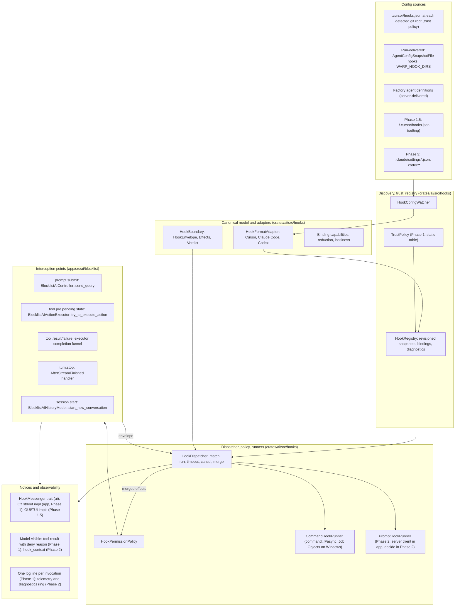

# Agent hooks in Warp: architecture proposal

Status: proposal for engineering review. Baseline: `warp` at `393e97a30a5ed85cf062b75e88326f83746dbecb` (master), vendor documentation read on 2026-10-19. Code paths are relative to the repository root and are cited as path plus symbol; line numbers drift and are not used. Supporting material: `cursor-hooks-coverage.md` (per-hook coverage verdicts), `research/01-cursor-hooks-catalog.md`, `research/02-claude-code-and-codex-hooks.md`, `research/03-warp-agent-loop-map.md`, `research/04-warp-config-process-infra.md`, and `research/05-cursor-cloud-ask-behavior.md`.

## 1. Summary and recommendation

Agent hooks let a user or team run their own scripts, and later model-evaluated prompts, at fixed points in Warp's agent loop: before and after tool calls, when a prompt is submitted, when a turn ends, and at session boundaries. A command hook receives one JSON object on stdin and may return one JSON object on stdout to observe, deny, require confirmation, annotate, or (later) rewrite what the agent does. Prompt hooks evaluate the equivalent payload through a server API. Cursor's `hooks.json` is the first supported format. Claude Code and Codex formats follow as additional adapters.

The recommendation is a layered system with one canonical model in the middle. Format adapters parse vendor configs, encode Warp's canonical envelope into each vendor's wire shape, and decode vendor output into typed effects. Each binding (a Warp boundary, a vendor event, and an adapter) declares which effects it may produce and how it fails, and those declarations are validated when the source is activated. The loop and the process runner never see vendor vocabulary. The pre-tool hook runs at dispatch time inside the existing executor, so it judges the operation that will actually run, and one component, `HookPermissionPolicy`, is the only place hook verdicts meet Warp's own permission result. Permissions are tightening-only in the first release; a bounded, AgentDecides-only form of loosening comes later. Where a hook file lives never grants permission to execute it: project hooks activate automatically only when the run already auto-approves command execution, and otherwise need an explicit decision. Warp follows documented vendor defaults where known and labels its choices where the docs are silent or conflict, with one "strict hook policy" setting for uniform fail-closed behavior.

**Key decisions.** Each is argued in the section named; rejected alternatives are collected in §13.

1. One canonical hook model sits in the middle. Vendor vocabulary stays inside format adapters, and each binding declares the effects it may produce, validated at activation (§4). Rejected: implementing Cursor's format directly in the loop; a universal superset event bus.
2. The pre-tool hook runs at dispatch time, inside `BlocklistAIActionExecutor::try_to_execute_action`, through a pending-hook state (§6.1). Rejected: running it during queue-time preprocessing, which sees stale cwd and pre-edit command text; per-executor hooks, except as a fallback for deny-only and observe-only hooks.
3. Hooks only tighten permissions in Phase 1. A later phase adds bounded loosening: a hook `allow` can satisfy only the confirmation Warp would show under `AgentDecides`, never `AlwaysAsk`, denylists, or protected paths, and only for sources with a separate "may approve" grant. Both live in `HookPermissionPolicy` (§6.5). Rejected: hooks decide first; tighten-only forever.
4. Phase 1 config sources are project `.cursor/hooks.json` at each detected git root, explicit sources delivered with the run (`AgentConfigSnapshotFile` and a `WARP_HOOK_DIRS`-style input), and factory agent definitions. The user file `~/.cursor/hooks.json` follows in Phase 1.5 behind a setting (§7). No Warp-owned hooks file is planned. Rejected: default-on import of the user file; a Warp-owned file in Cursor's schema.
5. Location never grants permission to execute code. A `TrustPolicy` decides activation: project hooks activate automatically when the run's execution profile already auto-approves command execution, explicit run sources are approved by construction, and anything else needs an explicit flag or config entry. The active set is pinned at run start, and hook files and scripts become protected write paths (§8). Rejected: unconditional automatic trust regardless of the run's permission posture.
6. Vendor-faithful defaults with one "strict hook policy" setting. A control effect that the current phase or surface cannot honor denies on a pre-execution boundary; it is never dropped silently (§4.3, §4.4, §6.4). Rejected: silently dropping effects; presenting stricter Warp semantics as format parity.
7. Input rewrites wait for Phase 2 and run under a two-pass contract (§6.2). Rejected: one-pass parallel rewrites.
8. A dedicated stdin-capable runner on `command::r#async`, with Job Object cleanup on Windows. The canonical model, adapters, registry, config watcher, trust policy, permission policy, dispatcher, and command runner all live in `crates/ai/src/hooks`; interception points, notice implementations, settings wiring, and the server client stay in `app`. No new crate (§3, §9.1). Rejected: reusing `CommandExecutor`; a separate `warp_hooks` crate; splitting the runtime into `app`.
9. Server-owned moments (automatic compaction, server-side subagents, remote-child stop relay) stay out of scope, with no server checkpoints (§10). Rejected: server checkpoints in Phase 2.
10. Phase 1 is cloud and CLI only: Oz cloud runs and `warp agent run`, including remote orchestration children. The GUI and TUI stay inert until Phase 1.5 (§10, §11).

Delivery is four phases, with tentative estimates. Phase 1, cloud and CLI (tentatively 5 to 6 client weeks plus about 1 server week), ships the canonical model, the Cursor adapter, discovery of project and run-delivered sources under the static trust policy, the runner with Windows Job Objects, the dispatch-time pre-tool hook without rewrites, the tool, stop, prompt, session-start, response, and reasoning events, tightening-only composition, and a small proto and server change so a hook's deny reason reaches the model for every tool. Phase 1.5, interactive surfaces (tentatively 2 to 3 client weeks), enables the GUI and TUI: settings and palette toggles, the per-root trust review card, the first-run discovery prompt, the user file, and the GUI and TUI notice implementations. Phase 2 (tentatively 6 to 8 client weeks plus 2 to 3 server weeks, with the server estimate unvalidated) supports 18 of Cursor's 21 event names within the limits in §10. It adds rewrites under the two-pass contract, bounded loosening, `hook_context` fields for `additional_context`, prompt hooks, the remaining events, and observability. `afterAgentResponse` ships in Phase 1 on a client-side heuristic: a text message is treated as final when the next message starts or the stream ends. Phase 3 adds Claude Code and Codex adapters at a tentative 3 to 4 weeks each. Cursor's two Tab hooks and `workspaceOpen` are excluded because Warp has no inline-completion surface and no project-open event (`cursor-hooks-coverage.md` §3.19 to §3.21).

## 2. Goals, non-goals, principles

**Goals.** Run existing Cursor command hooks with documented compatibility limits. Support every surface that runs the native loop: Oz cloud runs, `warp agent run`, native orchestration children, and (from Phase 1.5) the GUI and the TUI. Admit new formats and prompt hooks without changing the loop or the runner. Make denials, failures, unsupported features, and configuration provenance visible. Keep Warp's safety floors independent of hooks. Ship behind one feature flag with deterministic, testable decisions.

**Non-goals.** Hooks inside external harnesses (Claude Code or Codex running in Warp): those harnesses own their tools and hooks, and `ConversationDriver::executes_tool_calls_locally` (`app/src/ai/agent/conversation_driver.rs`) is false for them. Sandboxing hook processes or claiming a data-loss-prevention boundary. Reproducing every Claude Code lifecycle event. Guaranteeing cleanup after crashes or exactly-once external side effects. Authoring hooks into third-party agents, which is the existing CLI-agent plugin system (`research/04-warp-config-process-infra.md` §7).

**Principles.**

1. One canonical model; vendor vocabulary stays inside adapters.
2. Separate configuration location, format, execution host, and authority. A Cursor-shaped file may live anywhere; where it lives never grants permission to execute it. The run's permission posture or an explicit decision does.
3. Decisions are typed and merged deterministically by source priority and array order, never by completion time.
4. Vendor-faithful defaults; a single strict override. Strict mode is a Warp policy, not format parity.
5. Hooks can tighten from any source. Loosening is a separately granted capability and never crosses Warp's floors.
6. A control effect (one that changes what the agent does) that the current phase or surface cannot honor denies on a pre-execution boundary. Silently dropping a rewrite or a denial is the one failure that must not happen. An observational effect that cannot be delivered is logged.
7. The decision must describe the operation that will run: final arguments, current cwd, current configuration revision.
8. Reuse infrastructure, not incidental semantics: the MCP watcher's discovery loop is reusable; its no-prompt trust posture is not.

## 3. Layered architecture

**Placement.** The whole hook system except its interception points lives in `crates/ai/src/hooks/`: the canonical model, the adapters, the config watcher, the trust policy, the registry, the permission policy, the dispatcher, and the command runner. `ai` already depends on `warpui_core`, `watcher` (native only), `regex`, and `serde_json`, and it already keeps native-only modules behind the `local_fs` feature; the file-watching and process-spawning parts of the hook system use the same gating, with explicit unavailable stubs for wasm (`research/04-warp-config-process-infra.md` §4). Two things the runtime needs are injected from `app` rather than depended on, with the same precedent as the `ProjectRuleContentReader` function pointer in `crates/ai/src/project_context`: login-shell PATH capture (`LocalShellState::get_interactive_path_env_var`, `app/src/terminal/local_shell/mod.rs`) and the per-surface notice sink (a `HookMessenger` trait defined in `ai`, implemented in `app`). What stays in `app`: the interception points inside `app/src/ai/blocklist`, the GUI, TUI, and Oz notice implementations, settings and feature-flag wiring, and the `ServerApi` client the Phase 2 prompt runner will use (whether that runner moves to `ai` is decided in Phase 2). No new crate is needed, and both `warp_tui` and the Oz binary already consume `app` and `ai`.

**Registry versioning.** "Versioned" means two things only: a revision counter that invalidates in-flight decisions when a source changes, and the last valid snapshot kept active when a reload fails to parse. No history is retained.

**Components.**

- **Canonical model** (`crates/ai/src/hooks/model.rs`). Boundaries, envelope, effects, five-valued verdict, reduction rules. Reuses `AIAgentActionType` and `AIAgentActionResultType` (`crates/ai/src/agent/action/mod.rs`, `action_result/mod.rs`) for tool identity and payload encoding.
- **Format adapters** (`crates/ai/src/hooks/adapters/`). A static registry of known formats, modeled on `SKILL_PROVIDER_DEFINITIONS` (`crates/ai/src/skills/skill_provider.rs`) and `MCPProvider` (`app/src/ai/mcp/mod.rs`). Each implements parse, binding declaration, matcher evaluation, input encoding, and output decoding.
- **HookConfigWatcher** (`crates/ai/src/hooks/watcher.rs`, behind `local_fs`). Finds and watches project files at each detected git root and loads run-delivered sources, re-parses on change with generation tags, and publishes revisions and diagnostics. Modeled on `FileMCPWatcher`, `global_config_sources`, `PendingScan`, and `update_servers_from_config_file` (`app/src/ai/mcp/file_mcp_watcher.rs`). Roots come from `DetectedRepositories::get_root_for_path` (`crates/repo_metadata/src/repositories.rs`); cloud roots arrive through `register_cloned_repo` (`app/src/ai/agent_sdk/driver/environment.rs`); the user file and `HomeDirectoryWatcher` are added in Phase 1.5.
- **TrustPolicy** (`crates/ai/src/hooks/trust.rs`). A trait that answers "may this source activate on this surface". The Phase 1 implementation is a static table keyed by surface, source kind, and the execution profile's command-execution posture (§8). Phase 1.5 adds an interactive implementation backed by a local approval store and the review card.
- **HookRegistry** (`crates/ai/src/hooks/registry.rs`, an entity model registered at startup). Immutable snapshots of active bindings with provenance and a revision counter; answers "bindings for this boundary at this cwd and host"; keeps the last valid snapshot on malformed reload. Root resolution follows `FileBasedMCPManager::get_servers_for_working_directory` (`app/src/ai/mcp/file_based_manager.rs`).
- **HookDispatcher** (`crates/ai/src/hooks/dispatch.rs`). The one call the loop makes: fire an envelope, get merged effects. Pins a registry snapshot for each hooked action, runs matches concurrently under a bound, applies deadlines and cancellation, decodes through the adapter, reduces, logs, and routes notices.
- **HookPermissionPolicy** (`crates/ai/src/hooks/permission.rs`). The only component that composes a merged hook verdict with Warp's own permission result (§6.5). Tightening-only in Phase 1; bounded loosening later; changed in one place.
- **CommandHookRunner** (`crates/ai/src/hooks/runner/command.rs`, behind `local_fs`). A dedicated one-shot JSON-over-stdio spawner on `command::r#async::Command` with a process group on Unix and a Job Object on Windows (`crates/command/src/async.rs`). It is not built on `CommandExecutor::execute_command` (`app/src/terminal/model/session/command_executor.rs`), which has no stdin parameter, nor on `LocalCommandExecutor::execute_local_command_internal`, which forces null stdin. PATH capture is injected from `app`; the timer, SIGTERM, grace, kill shutdown pattern comes from `lsp::ProcessTransport` (`crates/lsp/src/transport.rs`).
- **PromptHookRunner** (Phase 2). Calls a new warp-server evaluator, following the REST pattern of `/ai/generate_block_title` (`app/src/server/server_api/block.rs`). The `ServerApi` client lives in `app`; where the runner itself lives is decided in Phase 2.
- **Interception points** (`app/src/ai/blocklist`; §5). Build envelopes, await the dispatcher where the boundary blocks, apply effects.
- **Notices** (`crates/ai/src/hooks/notices.rs` for the `HookMessenger` trait). Phase 1 has one implementation, Oz structured stdout via `AgentDriver::write_output` (`app/src/ai/agent_sdk/driver.rs`). Phase 1.5 adds the GUI (cards and `AgentNotificationsModel`, `app/src/ai/agent_management/agent_management_model.rs`) and TUI (hints) implementations. Denials are durable notices attached to the action, not only toasts.
- **Observability.** Phase 1 writes one `log::` line per hook invocation: event, source, exit code, duration, and a stderr tail, with no payloads. Telemetry via `register_telemetry_event!`, a per-conversation diagnostics ring, and any panel are Phase 2.
- **Activation controls.** `FeatureFlag::AgentHooks` (`crates/warp_features/src/lib.rs`). Phase 1: run configuration fields in `AgentConfigSnapshotFile` (`app/src/ai/agent_sdk/config_file.rs`) and the `WARP_HOOK_DIRS` input. Phase 1.5: a `define_settings_group!` group (`app/src/settings/ai.rs`) with palette toggle pairs for hooks enabled, read Cursor user file, strict hook policy, and default timeouts.

## 4. Canonical model and adapters

### 4.1 Boundaries and vendor mapping

Boundaries are grounded in moments Warp's loop can supply. A new boundary is added only when Warp can provide its timing and honor at least one of its effects. Several vendor events project onto one boundary; the adapter's matcher and payload view distinguish them.

| Canonical boundary | Cursor | Claude Code | Codex | Phase |
| --- | --- | --- | --- | --- |
| `session.start` | `sessionStart` | `SessionStart` | `SessionStart` | 1 (observe) |
| `session.end` | `sessionEnd` | `SessionEnd` | `SessionEnd` | 2 |
| `prompt.submit` | `beforeSubmitPrompt` | `UserPromptSubmit` | `UserPromptSubmit` | 1 |
| `tool.pre` | `preToolUse`; shell and MCP facets `beforeShellExecution`, `beforeMCPExecution` | `PreToolUse` | `PreToolUse` | 1 |
| `tool.permission_request` | — | `PermissionRequest` | `PermissionRequest` | 3 |
| `tool.result` | `postToolUse`; facets `afterShellExecution`, `afterMCPExecution`, `afterFileEdit` | `PostToolUse` | `PostToolUse` | 1 (edit facet 2) |
| `tool.failure` | `postToolUseFailure` | `PostToolUseFailure` | — | 1 |
| `file.exposure` | `beforeReadFile` | — (reads use `PreToolUse`) | — | 2 |
| `subagent.start` | `subagentStart` | `SubagentStart` (context only) | `SubagentStart` (context only) | 2 |
| `subagent.stop` | `subagentStop` | `SubagentStop` | `SubagentStop` | 2 |
| `turn.stop` | `stop` | `Stop` | `Stop` | 1 |
| `turn.interrupt` | — | — | `Interrupt` | 3 |
| `compaction.pre` | `preCompact` (manual only) | `PreCompact` | `PreCompact` | 2 |
| `compaction.post` | — | `PostCompact` | `PostCompact` | 3 |
| `response.complete` | `afterAgentResponse` (client heuristic) | — | — | 1 (observe) |
| `reasoning.complete` | `afterAgentThought` | — | — | 1 (observe) |

Parsed, reported as unsupported, and never fired: Cursor `beforeTabFileRead`, `afterTabFileEdit`, `workspaceOpen`; Claude `Notification`, `PermissionDenied`, `PostToolBatch`, `StopFailure`, `UserPromptExpansion`, `MessageDisplay`, `Setup`, `InstructionsLoaded`, and the task, teammate, config, cwd, directory, file, worktree, model-switch, and elicitation events.

`file.exposure` is a distinct boundary rather than a facet of `tool.result`. Its timing is "content has been read locally but not yet shown to the model", and its failure semantics are those of a permission hook (`research/01-cursor-hooks-catalog.md` §2.2). Its scope follows Cursor's semantics as closely as Warp's tool set allows. It fires for the agent-invoked tools that read specific files, `ReadFiles`, `ReadSkill`, and `GetFiles`, once per file. For `SearchCodebase` the search runs first, and the hook then checks each surfaced file before its content reaches the model. Project rules are not checked; as in Cursor, rule files appear in the `attachments` array with type `rule`. `Grep` match lines are not checked either, which matches Cursor's `Read`-only scope. Cursor's docs do not say whether loading a skill fires `beforeReadFile`; Warp fires it for `ReadSkill` deliberately, since there is no skill-specific hook (`cursor-hooks-coverage.md` §3.12).

### 4.2 Envelope

The envelope is the in-memory, format-neutral superset of everything a boundary knows. Adapters serialize it into the vendor's stdin shape; scripts never see the envelope itself. For the Cursor adapter the stdin payload is Cursor's documented JSON for that event.

Common fields, with missing values absent rather than fabricated:

- `schema_version`, `occurrence_id`, `invocation_id`.
- `conversation_id` (`AIConversationId`, which exists before the server token; `research/03-warp-agent-loop-map.md` §2).
- `turn_id`: a user-turn identifier allocated by the prompt-submit hook and carried across every exchange of that turn. This is what Cursor's `generation_id` and Claude's `prompt_id` map to. `AIAgentExchangeId` changes per request, including tool-result follow-ups, so it is exposed separately as `exchange_id` (`AIConversation::turn_exchange_ids`, `app/src/ai/agent/conversation.rs`). `exchange_id` is optional because `session.start` precedes any exchange.
- `action_id` (`AIAgentActionId`) on tool boundaries; `run_id`, parent ids, and child correlation ids when available.
- `surface` (Oz run, CLI run, local child; GUI and TUI from Phase 1.5), `execution_host`, `cwd`, `roots`, `source_revision`.
- Model metadata (`LLMId`), user email, Warp version, hook protocol version (precedent: `warp_core::cli_agent_protocol`).
- Permission facts: whether Warp's own check would ask, the active autonomy level, and the derived vendor `permission_mode` where an adapter needs it.

Per-boundary payloads use Warp's own types serialized to neutral JSON: the action and its arguments, cwd, timing, result or failure, and facets (shell adds the model's command, execution state, sandbox flag, captured output; MCP adds stable server identity and transport metadata; file exposure adds host-qualified path, text or an explicit unsupported content kind, range, and revision; edits add path, old and new text, and saved outcome). Shell hooks see the model's command, not the decorated command Warp runs (pager flags, PowerShell wrapping). The proto `risk_category` is dropped today in `From<RunShellCommand>` (`crates/ai/src/agent/action/convert.rs`); plumbing it is a small prerequisite so policy hooks can key on it.

### 4.3 Effects and verdicts

An effect bundle has independent channels: verdict with reason; replacement input; replacement model-visible result; model context; user notice; hook-session environment; halt turn; continuation request. Rewrites are whole validated objects, never partial mutations of app state.

Two words are used precisely throughout this document. A **control effect** changes what the agent does: deny, ask, rewrite input, replace a result, halt the turn, request a follow-up. An **observational effect** does not: a user notice, a log line, session environment for later hooks. An effect is **unsupported** when the current phase or surface cannot honor it. An unsupported control effect on a pre-execution boundary denies; an unsupported observational effect is logged.

The verdict is five-valued: no opinion, allow, deny, ask, defer. `Defer` is represented because Claude Code defines it, but resumable deferral is unsupported in Warp. Claude's reference says `defer` "exits gracefully so the tool can be resumed later", is honored only in non-interactive `-p` runs where the host process reads `stop_reason: "tool_deferred"` and later resumes, is restricted to a single pending tool call, ignores `updatedInput` and `additionalContext`, and in interactive sessions "logs a warning and ignores the hook result". Warp follows the interactive warning-and-ignore behavior. On headless surfaces it rejects the unsupported control effect with a specific diagnostic and does not execute the action; it does not claim to have suspended work for later resume. This is not an approval-unavailable result or an `ask` decision.

### 4.4 Per-binding capabilities

A binding is one boundary, one vendor event, and one adapter. It declares the effects that vendor event may produce (for example Cursor `preCompact` produces only a user notice; Claude `PreCompact` may halt), the failure semantics (fail-open or fail-closed, and how malformed or empty output is treated), the matcher target, and the handler kind. At activation the registry validates those capabilities against what the boundary can honor in the current phase and warns about gaps. It cannot predict an arbitrary script's output; the warning says that a rewrite, if emitted, will be rejected. At runtime, a control effect that the binding does not permit or the phase cannot honor denies on a pre-execution boundary and is reported on any other boundary. Vendor-defined ignored fields remain governed by the adapter's documented defaults. Capabilities therefore attach to the binding and the boundary, not only to the event enum.

### 4.5 Lossiness tables

Cursor adapter:

| Cursor feature | Warp behavior |
| --- | --- |
| `preToolUse` `ask` | Ignored by default, as Cursor documents; honored as `ask` in strict mode |
| `subagentStart` `ask` | Treated as deny, as Cursor documents |
| `updated_input` | Phase 1: a rewrite on a pre-execution boundary denies with a diagnostic. Phase 2: two-pass contract (§6.2) |
| `additional_context`; denial `agent_message` | Additional context is Phase 2 after `hook_context` protos exist (§9.3). Cursor's `agent_message` applies on denial and travels inside the denied tool result; Phase 1 adds the missing wire slots for shell and the empty-result tools |
| `beforeReadFile` | Fires after the local read, before model exposure, for `ReadFiles`, `ReadSkill`, `GetFiles`, and each file surfaced by `SearchCodebase`; not for project rules (sent as `rule` attachments) or `Grep` lines |
| `preCompact` | Manual `/compact` only; automatic compaction is server-side and unsupported |
| `subagentStart`, `subagentStop` | Native children only, parent-side: start can allow or deny; stop is observational. Server-side subagents and child `followup_message` are not advertised |
| `afterAgentResponse` | Phase 1 client heuristic: emit once per text message when the next message starts or the stream ends. `afterAgentThought` uses reasoning `finished_duration` and is exact |
| `transcript_path` | `null`; Warp keeps transcripts in SQLite |
| `cursor_version`, `CURSOR_VERSION` | Format-driven labeled compatibility values, set for every Cursor-format source including run-delivered and factory sources; `warp_version` carries the real version |
| Scalar output merge | Highest-priority source wins; Cursor's pages disagree with each other (§7.4) |
| `loop_limit` | Per-definition count within one continuation chain plus a host cap of 8 |
| Tab hooks, `workspaceOpen` | Never fire |
| Prompt hooks | Phase 2, after the evaluator; documented shell example first |

Claude Code adapter (Phase 3):

| Claude feature | Warp behavior |
| --- | --- |
| Roughly two-thirds of events | Parsed, reported unsupported, never fire |
| `defer` | Represented; ignored interactively with a warning; headless resumable deferral is rejected as unsupported, not treated as `ask` |
| `PermissionRequest` | `tool.permission_request`; fires only when Warp would show a confirmation; its allow is the bounded-loosening path and needs the "may approve" grant |
| `updatedToolOutput` (any tool) | Honored where the Warp result has a replaceable payload; otherwise reported |
| `http`, `mcp_tool`, `agent` handlers; `asyncRewake`; `once`; `if` | Unsupported; `async` runs detached and observe-only |
| `terminalSequence`, `watchPaths`, `sessionTitle`, `initialUserMessage`, `suppressOriginalPrompt`, `CLAUDE_ENV_FILE` | Unsupported |
| Plain-text stdout as context | Honored only once `hook_context` exists |
| `transcript_path` | `null` although the SDK types mark it required |
| Exit code 2 per event | Honored per Claude's table where the event exists |
| Matcher dialect | Exact-name rule plus unanchored regex; JavaScript-only syntax rejected with a diagnostic |

Codex adapter (Phase 3):

| Codex feature | Warp behavior |
| --- | --- |
| `Interrupt` | `turn.interrupt`, observational |
| `PreToolUse` `ask` | Failed hook that proceeds, as Codex documents; honored in strict mode |
| `PermissionRequest` | As for Claude |
| `PostToolUse` `decision: "block"` | Replaces the model-visible result with the reason when the Codex adapter ships in Phase 3, using Phase 2 result-replacement support |
| `commandWindows`, `config.toml` `[hooks]` | Honored; TOML normalized as the MCP parser already does |
| `async`, `mcp_tool`, `prompt`, `agent` | `async` detached; `mcp_tool` unsupported; `prompt` and `agent` not run, matching Codex |
| `additionalContextLimit` | Ignored |
| Completion-order rewrite resolution | Not reproduced; deterministic order instead |

## 5. Interception points

| Canonical boundary | Warp seam | Blockable | Modifiable | Phase |
| --- | --- | --- | --- | --- |
| `session.start` | `BlocklistAIHistoryModel::start_new_conversation` (`app/src/ai/blocklist/history_model.rs`); barrier before first `send_request_input` | Barrier only; creation cannot be denied | Hook env; context in Phase 2 | 1 |
| `session.end` | Conversation delete, surface close; Oz `AgentDriver::cleanup` (awaited) | No | No | 2 |
| `prompt.submit` | `BlocklistAIController::send_query` (`app/src/ai/blocklist/controller.rs`), made async by spawn and continuation; allocates `turn_id` | Yes (halt) | Prompt rewrite has no vendor field | 1 |
| `tool.pre` | Pending-hook state in `BlocklistAIActionExecutor::try_to_execute_action` (§6.1) | Yes | Rewrites Phase 2 | 1 |
| `tool.permission_request` | Same seam, fired only when Warp's verdict is "ask" | Yes | Rewrites Phase 2 | 3 |
| `tool.result`, `tool.failure` | One completion funnel holding results before `BlocklistAIActionModel::handle_action_result` (`app/src/ai/blocklist/action_model.rs`), covering async futures, synchronous results, denials, and cancellations | Holds the result | Replacement output Phase 2 | 1 |
| `file.exposure` | Completion of `ReadFilesExecutor`, `ReadSkillExecutor`, and `GetFilesExecutor` (`app/src/ai/blocklist/action_model/execute/`), and `SearchCodebase` results after the search runs, with content in a private buffer | Yes, per file | Range filtering | 2 |
| `subagent.start` | `RunAgentsExecutor::execute` before dispatch (`app/src/ai/blocklist/action_model/execute/run_agents.rs`) | Yes | Child context for later adapters | 2 |
| `subagent.stop` | `inject_pending_events_for_request` and the follow-up piggyback path in the controller | No | Follow-up not advertised | 2 |
| `turn.stop` | `AfterStreamFinished` handling in the controller, before `Success` is finalized | Hold finalization | Follow-up | 1 |
| `turn.interrupt` | `CancellationReason` paths | No | No | 3 |
| `compaction.pre` | `/compact` via `SlashCommandRequest::Summarize` | Manual only | No | 2 |
| `compaction.post` | Finished `Message::Summarization` | No | No | 3 |
| `response.complete` | Streaming text (`app/src/ai/agent/api/convert_from.rs:ConvertAPIMessageToClientOutputMessage::to_client_output_message`); next-message/stream-end heuristic | No | No | 1 |
| `reasoning.complete` | Same converter; reasoning `finished_duration` marks completion | No | No | 1 |

Tool calls are queued only after the whole response has streamed (`AfterStreamFinished` then `queue_actions`), so pre-tool hooks run between model requests. Detached response and reasoning observers may run while the rest of the response is still streaming. They cannot inject into the in-flight model request or revise text already streamed into the proto history that is replayed to the server (`research/03-warp-agent-loop-map.md` §3.k).

## 6. Decision semantics and permission composition

### 6.1 Dispatch-time pre-tool hook

The pre-tool hook runs at dispatch, inside `BlocklistAIActionExecutor::try_to_execute_action`, for three reasons.

1. A hook `ask` must be resolved before Warp's own confirmation decision, and that decision is made in `try_to_execute_action` before any executor's `execute()` is called. A hook that ran later could not add a confirmation requirement.
2. `ShellCommandExecutor::execute()` starts the command synchronously: it emits `ShellCommandExecutorEvent::ExecuteCommand` before returning its future (`research/03-warp-agent-loop-map.md` §3.d). A per-executor hook for shell would therefore need that executor restructured anyway, which removes the main attraction of the per-executor approach.
3. One call site is what makes `HookPermissionPolicy` real. If each executor composed verdicts on its own, the tightening-only rule and the later loosening rule would be reimplemented per tool.

It also has to be dispatch time rather than queue time: `BlocklistAIActionModel::queue_actions` preprocesses a whole batch before any action runs, so a queue-time check would see the cwd and files as they were before earlier commands in the same batch executed, and `handle_requested_command_accepted` can change the command text after a queue-time decision.

`try_to_execute_action` is synchronous today, so the hook needs a small state machine. The existing `NotExecutedReason::NotReady` already means "re-insert this action and try again later" and can most likely represent "waiting on hooks"; if a distinct variant is needed, it is one more arm in the same enum. The sketch:

- A cached verdict is keyed by action id, argument revision, cwd, and registry revision.
- Without a valid verdict, `try_to_execute_action` returns `NotExecuted`, the action model keeps the action pending and marks it "checking hooks", and the executor spawns the dispatcher future. Several actions may wait during a parallel read-only phase.
- On completion the verdict is cached and the action model re-enters `start_pending_action_by_id`. `try_to_execute_action` now finds the verdict and hands it with Warp's own result to `HookPermissionPolicy`: deny produces a denied result, ask requires confirmation, and allow or no opinion leaves Warp's own checks in place. The denied result carries the hook's reason on the wire (§9.3).
- The user-initiated path (`execute_action` after a confirmation card) consults the same cache. A changed command, cwd, or registry revision invalidates the verdict and the hook runs again. Approval satisfies a hook `ask` only for the exact approved revision and never bypasses a hook `deny`.
- Cancellation kills pending hook processes and prevents execution. Disabling the feature cancels every pending invocation.

This is the most delicate edit in the proposal because it sits on the action model's hot path, but it is smaller than it first appears: one `NotExecutedReason` arm, one cache, one re-entry through an existing method. Costs that remain: a denied action is briefly visible as pending (on surfaces with a pending UI); a rewritten file edit (Phase 2) requires `preprocess_action` to run again and a second diff to be generated, and the user must see the final diff before approving.

### 6.2 Rewrites

Phase 1 does not support `updated_input`. On a pre-execution boundary, a rewrite the current phase cannot honor denies with a diagnostic; it is never dropped silently. Phase 2 adds rewrites under an explicit two-pass contract: apply the rewrite as a whole validated object; clear the model's risk flags (`is_read_only`, `is_risky`, and the newly carried `risk_category`), because they describe the old command and `BlocklistAIPermissions::can_autoexecute_command` can auto-allow based on `is_read_only` or `is_risky` under `AgentDecides`; recompute preprocessing and permissions; re-run the matching pre-execution hooks on the final input; any deny survives; a second, different rewrite fails as unstable. There is no fixed-point loop. This is documented as Warp behavior: all matching pre-execution hooks may run twice when any hook rewrites, and Cursor does not promise hook idempotence.

### 6.3 Merging across hooks and sources

All matching bindings run concurrently against the same immutable input. Results merge in a fixed order: source priority, then array index in the config. Verdicts merge by severity, deny over ask over allow over no opinion. Halt is any-wins. Notices and model context concatenate in merge order. Scalar fields (replacement input, replacement output, continuation) take the highest-priority value; conflicts are logged. Identical resolved sources (the same file reached through two paths) run once; identical command text in different sources is not deduplicated.

### 6.4 Failure policy, timeouts, strict mode

Defaults follow the adapter's documented semantics. For Cursor: exit 2 denies; other non-zero exits, crashes, and timeouts fail open unless `failClosed`; malformed non-empty output fails closed on Cursor's six permission hooks (`beforeShellExecution`, `beforeMCPExecution`, `beforeReadFile`, `beforeTabFileRead`, `subagentStart`, `preToolUse`) even without `failClosed`; empty stdout is a no-output failure governed by `failClosed`; malformed output on `beforeSubmitPrompt` follows `failClosed` because Cursor's rule is unstated. Observers report failures and continue. Post-result failures preserve the original result. A failed `session.start` adds no context or environment. A failed stop hook does not continue the turn. Cancellation never becomes fail-open execution.

One setting, "strict hook policy", turns every evaluation failure on a permission-style event, including timeout, crash, malformed output, and unsupported control output, into denial. It also honors schema-accepted `ask` values that the vendor would otherwise ignore or treat as a failed-open hook. It never weakens a vendor denial into an ask, so Cursor `subagentStart.ask` still denies. It is a Warp policy for security deployments and is not described as format parity.

Proposed default timeouts, flagged as a judgment call because Cursor publishes none: 30 seconds for pre-execution boundaries, 60 seconds for post-tool and other boundaries, 5 seconds for `session.end`. All are configurable per definition; values above an activation-policy ceiling are rejected rather than truncated.

The Cursor adapter uses Rust `regex`, unanchored and case-sensitive; `""` and `"*"` match everything. Later adapters retain their exact-name and event-specific matching rules before compiling regex patterns. A matcher that fails to compile invalidates that definition. On hot reload of a file that was valid, the registry keeps the last valid snapshot active, marks it stale, and shows a diagnostic. On first activation, a source with errors stays inactive with an error.

### 6.5 Composition with Warp's permissions

`HookPermissionPolicy` is the only place a hook verdict is combined with Warp's own permission result. Its inputs are the merged hook verdict with reasons, Warp's `should_autoexecute` result (today a bool, consumed in `try_to_execute_action` together with `is_user_initiated` and the autonomous shell exception), and the named floors. Its output is a decision with a reason: execute, require confirmation, or deny. Preserving reasons keeps "hook denied" distinct from "needs confirmation". Changing the policy later, from tightening-only to bounded loosening, changes this one component.

Warp's floors are spread across `permissions.rs` today, not kept in one layer. `can_autoexecute_command` evaluates organization deny rules first but permits a setting to bypass the user denylist; `can_write_files` checks protected paths only outside sandbox mode; `can_use_mcp_server` returns early under auto-approve; and `is_user_initiated` bypasses a false autoexecute verdict entirely. Naming those floors explicitly, so the policy can promise never to cross them, is Phase 1 plumbing. It must not silently turn existing user-confirmable restrictions into absolute prohibitions.

Options:

- **Tighten-only forever.** Hook `allow` means "no objection". Simple and safe, but it breaks the documented meaning of `allow` for Claude hooks (which skip the default prompt) and makes policy automation impossible. Rejected as a permanent position; adopted for Phase 1.
- **Hooks decide first.** Hook `allow` auto-approves anything. Repository code could defeat user settings. Rejected.
- **Bounded loosening (recommended for a later phase).** Hook `allow` may satisfy only the confirmation Warp would show under `ActionPermission::AgentDecides`. It never applies under `AlwaysAsk`, never crosses the organization or user denylists or protected write paths, and is available only to sources granted a separate "may approve" capability, distinct from trust-to-run; project sources need that grant explicitly. Claude Code's reference also preserves deny and ask rules despite hook approval, but Warp's AgentDecides-only restriction is its own narrower policy, not an exact mapping of Claude permission modes.

Headless surfaces (Oz runs, `warp agent run`, hidden local children) have no approver. Hook `ask` degrades to deny with an "approval unavailable" reason that the model can read in the tool result; Phase 1 adds the wire slot that makes this true for shell and the empty-result tools as well (§9.3). The precedents are mixed, and `research/05-cursor-cloud-ask-behavior.md` records them: Cursor's docs do not define hook `ask` with no user present, in managed cloud, on self-hosted workers, or in `agent -p`, and its cloud agents auto-run commands without per-step approval; Claude Code documents deny-with-reason for `-p` runs ("Claude reads the reason in the tool result instead"); Codex treats `PreToolUse` `ask` as a failed hook and proceeds. Degrading to deny is the safe reading. A run flag can select the stricter fail-the-run behavior.

## 7. Config sources and precedence

### 7.1 Options

- **Cursor's own files only.** Lowest friction and the strongest compatibility expectation. Costs: scripts may assume Cursor's environment; a user's `~/.cursor/hooks.json` expresses intent about Cursor; when both products are used on one repo, both run the same formatters and notifications for their own sessions, and precedence cannot undo scripts that already ran.
- **A Warp-owned Cursor-schema file only.** Clear execution ownership and no cross-host surprise. Costs: no reuse without copying, and pressure to make a temporary schema choice Warp's permanent format.
- **Both.** Flexible, but duplicated definitions can run twice and users must understand that a lower-priority file still executes.

### 7.2 Recommendation

Phase 1 reads three kinds of source.

1. **Project files.** `<root>/.cursor/hooks.json` at each detected git root (§7.3), activated under the trust policy in §8.
2. **Explicit sources delivered with the run.** A `hooks` entry in `AgentConfigSnapshotFile` (`app/src/ai/agent_sdk/config_file.rs`), which rejects unknown keys today and needs the field added, and a `WARP_HOOK_DIRS`-style input modeled on `WARP_SKILL_DIRS` (`app/src/ai/agent_sdk/driver/agent_setup.rs`). Each names a path, a format, and a scope. These are approved by construction: whoever configured the run chose them.
3. **Factory agent definitions.** Factory trees declare skills by directory convention (`skills/**` factory-wide, `agents/<name>/skills/**` per agent) and declare `mcpServers` and `secrets` as fields, where an agent-level declaration replaces the inherited value. The hooks analogue proposed here is `hooks/hooks.json` at the factory root and `agents/<name>/hooks/hooks.json` per agent, in Cursor format, with scripts beside them and relative commands resolving against that directory. warp-server delivers them to the run as explicit sources. warp-server owns the factory file schema (published at `/api/v1/factory-files/schemas`), so the exact naming is decided together with that schema; this is a small Phase 1 server item. A named factory agent's effective hook set is its own definition plus project hooks under the trust policy. It is never inherited from the foreman or a parent agent.

Phase 1.5 adds the user file `~/.cursor/hooks.json` behind an explicit setting, with a first-run discovery prompt on the GUI and TUI when a project or user file is found and not yet active, so the feature does not look broken. Unattended runs emit a diagnostic instead.

A Warp-owned project and user file (for example `.warp/hooks.json` with a format discriminator) is a possible future addition if repository-scoped Warp-only policy is requested. It is not planned for any phase in this document. Claude Code and Codex files slot in later as additional sources after native ones.

### 7.3 Resolution rules

**What a project is.** Warp defines the project as the detected git root for the session cwd. `DetectedRepositories` walks up from the cwd to the nearest `.git` directory or gitfile and stops at `$HOME` (`crates/repo_metadata/src/repositories.rs`); it runs on every cwd change in the GUI and TUI and on environment prep in Oz for each cloned repo (`register_cloned_repo`). The hook set for a tool call is the one whose root contains the action's cwd. A cloud run with several cloned repos has one project set per root. A cwd outside any git repository has no project source. This is the same rule project rules (`WARP.md` and `AGENTS.md`) use today, and those files also load without a prompt.

Relative commands resolve against the project root for project files (as Cursor documents), against the config file's directory for user files (`~/.cursor` for Cursor's user file), and against the declaring directory for factory definitions and other explicit sources. Scope follows the active operation's host and root; the cloud behavior of treating every known directory as in scope is not copied from skills. Run-delivered sources stay active when cwd changes.

### 7.4 Precedence

Highest first: managed or team (future) → factory agent definition → factory-wide definition → other run-delivered sources → Cursor project file → Cursor user file (Phase 1.5) → Claude project-local, Claude project, Claude user → Codex project, Codex user. Precedence affects scalar fields and tie-breaks only; verdict severity ignores it. Scalar fields take the highest-priority value. Cursor's main page says the opposite ("last response wins", so a lower-priority source can override) and its third-party page says higher priority wins; Warp's choice is published as a compatibility note. Deduplication is by resolved source identity, never by command text. Lower-priority scripts still run, and precedence cannot undo their side effects.

## 8. Trust and activation

Location never grants permission to execute code. Reading project rules, skills, or MCP configs from a repository is not consent to run its scripts. No reusable native-agent workspace execution-trust mechanism was found in the inspected `app/src` and `crates/ai` code; the relevant trust writes configure third-party harnesses (`app/src/ai/agent_sdk/driver/harness/codex.rs:prepare_codex_config_toml`). Processes Warp spawns for itself have no separate sandbox in the inspected paths (`research/04-warp-config-process-infra.md` §3.5).

**TrustPolicy.** Activation is decided by a `TrustPolicy` trait in `crates/ai/src/hooks/trust.rs`. The Phase 1 implementation is a static table keyed by surface, source kind, and the execution profile's command-execution posture. The rule it encodes:

- Project hooks activate automatically when the run's execution profile already auto-approves command execution. The Oz default profile does (`create_default_cli_profile`, `crates/cloud_object_models/src/ai_execution_profile.rs`, sets every action to `AlwaysAllow`).
- Otherwise, project hooks need an explicit flag or configuration entry for the run.
- Explicit sources delivered with the run (the config-file entry, `WARP_HOOK_DIRS`, factory definitions) are approved by construction.

**Why this is safe enough.** In an all-`AlwaysAllow` run the agent can already run any script in the repository on its own initiative, so activating the repository's hooks adds no new capability. The marginal risks are three. First, hooks get guaranteed execution with full payload visibility, before any model decision; this is accepted as the purpose of the feature and is made visible by diagnostics. Second, the agent could write a hook file or a hook script and have it take effect mid-run; this is closed by pinning (below) and by protected write paths. Third, a run with a restrictive profile would otherwise have repository code run with authority the profile withholds; this is closed by the posture rule, since such a run gets no automatic activation.

**Pinning.** The active hook set is pinned at run start. Changed or newly written files during the run do not activate; the watcher reports them as diagnostics, and they take effect only at the next run start. Untrusted replacement definitions never activate automatically.

**Protected hook source files.** Hook configuration files and the scripts they name become protected write paths in `can_write_files`, next to the MCP config paths already checked there (`app/src/ai/blocklist/permissions.rs:check_protected_write_paths`). The guard must also apply in sandboxed runs and cannot be bypassed by hook approval. This is an agent file-edit guard, not operating-system write protection: shell commands and indirect scripts can still alter files. Enforcement-grade sources should live outside the writable checkout or be made read-only by the environment.

**Interactive surfaces (Phase 1.5).** On the GUI and TUI the posture rule is replaced by an explicit per-root approval. A project source is inert until the user approves it in a review card listing each event, matcher, and command or prompt, with the data each boundary exposes and the execution host. The approval is keyed by repository root, execution host, resolved source identity (so symlinks, worktrees, and SSH hosts are distinct), and configuration revision. Any configuration change requires re-approval and shows a diff. Warp records changes to scripts the configuration directly names where it can resolve them, without claiming to track arbitrary shell dependencies. Approvals are local and never synced. The separate "may approve" grant (§6.5) is never implied by trust-to-run; its UI also arrives with the interactive surfaces, ahead of the loosening it enables.

**Children.** Personal hooks are not silently inherited. Local children (Phase 1.5) share the parent's process and registry and run under the parent's approved project set; `inherit_child_agent_settings` (`app/src/ai/blocklist/child_agent_launch.rs`) copies profile and model only, not files. Remote children are Oz runs: they get an explicit effective source set through remote launch plumbing (`prepare_remote_child_launch`, `app/src/ai/orchestration/remote_child.rs`, which has no hook fields today) plus the project hooks of their own checkout under the posture rule. Passing a hook set does not move scripts, dependencies, or an approved execution host to another machine; the child's environment must already contain them, and a missing required source blocks launch.

## 9. Execution model

### 9.1 Command hooks

A dedicated one-shot runner spawns each hook through `command::r#async::Command`, outside the interactive PTY, in a process group on Unix and a Job Object on Windows. It writes one bounded JSON object to stdin and closes it, drains stdout and stderr concurrently, and parses only after exit. Payload bytes are never interpolated into shell source. Command strings run under the declared host shell; direct argv execution is kept available internally for future Claude `args` handlers. Runner activity never emits tool hooks recursively. Side-effecting hooks are not retried automatically; late output after cancellation is discarded.

Working directory: project root for project sources, the config file's directory for user sources, the declaring directory for factory and other explicit sources. Start with the runner host's environment under a documented scrub policy, HOME, the captured login-shell PATH (injected from `app`), and the hook-session environment. Then set protected host and protocol identity fields: `WARP_PROJECT_DIR`, `WARP_VERSION`, `WARP_HOOK_PROTOCOL_VERSION`, and `WARP_RUN_ID` when a run id exists. Vendor aliases are selected by the source's **format**, not its path: every Cursor-format source, including run-delivered and factory sources, receives the `CURSOR_*` aliases and the labeled `cursor_version` compatibility value. This includes `CURSOR_PROJECT_DIR`, `CURSOR_VERSION`, and `CLAUDE_PROJECT_DIR`; optional identity, transcript, and remote flags are populated only when available and applicable. Hook-session variables cannot replace these protected identity fields and affect later hooks only. Login profiles are not sourced per invocation; users wrap commands that need them.

Matching hooks run concurrently under a bounded dispatcher, with deadlines, output limits, and merge by source priority then array index. Timeout kills the whole process tree with the timer, SIGTERM, grace, kill sequence. On Windows the `command` crate gains Job Object support in Phase 1: create a job with kill-on-close, assign the child to it, and do not set `CREATE_BREAKAWAY_FROM_JOB` for hook children, so a timed-out hook cannot leave descendants mutating files. Windows is therefore supported in Phase 1. `cmd.exe` versus PowerShell command-string execution and Unicode stdin still need tests.

SSH and WSL sessions change the execution host. Hooks do not run silently on the local host against remote paths, and remote project scripts are never run locally as a fallback. These sessions are unsupported at first; a future explicit policy (local user hooks observing a remote session, or remote execution over a transport with stdin, cancellation, and host-bound trust) is a separate increment. `CommandExecutor` is a routing precedent, not that contract.

Displayed stderr has terminal control characters escaped. Disabling the feature kills pending invocations and invalidates their decisions.

### 9.2 Boundary-specific rules

- `session.start`: owned by `BlocklistAIHistoryModel::start_new_conversation` on every surface; `AgentDriver::execute_run` supplies run metadata to the envelope and does not fire a second event. A bounded initialization barrier runs before the conversation's first request; creation itself cannot be denied. Resume paths do not fire `session.start` in Phase 1.
- `session.end`: closure or run teardown, not each successful turn. Oz awaits it in `cleanup`; GUI and TUI fire it best-effort on conversation delete or surface close and do not wait.
- `turn.stop`: turn success is held until stop hooks finish, so Oz's idle-exit cannot race a follow-up. Follow-ups are honored only on `completed` status, pass the prompt-submit hook with hook provenance, reuse `QueuedQueryModel`, and queue behind real user input. Counting is per definition within one continuation chain, with a host cap of 8; `loop_limit: null` and larger values are capped and reported.
- `tool.result` for shell: an interact-mode command's tool result is a `LongRunningCommandSnapshot`, not completion. `postToolUse` describes that handoff; `afterShellExecution` waits for the real command to exit. PTY writes remain separate generic actions.
- `tool.result` for file edits: after `afterFileEdit` hooks finish, affected file snapshots are refreshed before the next model request, because a formatter may have changed what was just saved.
- `file.exposure`: full text within a size cap is gathered into a private buffer, the hook runs, approved ranges are returned; per-file denial removes that file from a batch with explicit feedback; binary or oversized content is denied with an unsupported-content diagnostic rather than presented partially. The same rule applies to `ReadSkill` and `GetFiles`. For `SearchCodebase` the search runs to completion first, then the hook runs once per surfaced file, and a denied file's snippets are removed from the results before the model sees them. Project rules content is not checked.
- `subagent.start` and `subagent.stop`: native children only, parent-side. Start can allow or deny before dispatch; stop is observational. Child `follow_up` is not advertised until its owner and transport exist; remote child resume through `AgentDriverOptions.resume` is a candidate, not a verified continuation contract. A child follow-up must never become a new prompt in the parent's turn.
- `response.complete`: treat a text message as final when the next message starts or its stream ends, and emit once for that message. This is a client heuristic, accepted for Phase 1, not a guarantee that the server will never update that message again. Observers may run while later messages stream. A server message-finality signal would make the boundary exact but is not a prerequisite.
- `reasoning.complete`: emit once when reasoning `finished_duration` arrives; do not treat every reasoning update as completion.

### 9.3 Model-facing context

`AIAgentInput::ActionResult { result, context }` does not transmit its context per result. `convert_input` (`app/src/ai/agent/api/convert_to.rs`) sends a single request-level context taken from the last input that has one, and `convert_input_to_user_input` converts each `ActionResult` to the bare request `ToolCallResult` proto, which has only `tool_call_id` and a per-tool result oneof with no generic error member.

In the MVP the only model-visible channel is therefore the tool result itself, which is how Claude Code delivers a hook's reason too. Most result families already carry text on the wire (MCP `Error { message }`, `read_files` failures, file-edit errors, `run_agents` `Denied { reason }`, and the other `Error(message)` results; `cursor-hooks-coverage.md` §3.0). Shell does not: `PermissionDenied.reason` on `RunShellCommandResult` is a oneof whose only member today is the empty `denylisted_command`, and the client conversion drops `CancelledBeforeExecution` from the wire (`crates/ai/src/agent/action_result/convert.rs:TryFrom<RequestCommandOutputResult>`). The empty-result tools (`InitProject`, `OpenCodeReview`, `WaitForEvents`, `SuggestNewConversation`, `SuggestPrompt`) have no slot either.

Phase 1 therefore includes a small proto and server change: a `hook_denied { string reason }` member in `PermissionDenied.reason`, text-bearing denied variants for the empty-result tools, server rendering of those reasons to the model, and the client conversion updated so no denial is dropped or relabeled as a denylist match. With that in place, a hook's deny reason reaches the model for every tool from the first release. `hook_context` fields on the request and result protos, with provenance and server rendering, carry `additional_context` and stay in Phase 2; the first customer does not need them. Cursor's denial-only `agent_message` uses the denial channel, not a new non-deny effect.

Encoding hook text as `SelectedText` or appending it to command output are not compatible channels and are not offered: the first mislabels policy text as user material and the second changes the apparent tool result.

### 9.4 Prompt hooks

Prompt hooks need a tool-free warp-server evaluator: prompt template plus projected input with `$ARGUMENTS` substitution or append, requested model, deadline, tenant and run identity, and a strict `{ok, reason}` response. The native agent's model calls go through warp-server (`research/04-warp-config-process-infra.md` §6). The legacy `GenerateDialogue` client API accepts no model override (`app/src/server/server_api/ai.rs:AIClient::generate_dialogue_answer`); its billing and cancellation behavior has not been established as suitable for hook evaluation. Authorization, model routing and allowlists, billing, token limits, structured validation, cancellation, and isolated logging are open. Unknown model aliases are rejected, not substituted.

Sending hook input to the evaluator is itself disclosure, so a prompt hook cannot be the control that stops data leaving the machine. File-content policy must use local command hooks or explicit consent. The initial implementation uses the documented Cursor shell-permission example and maps `ok: false` to denial and `ok: true` to no restriction; Cursor does not fully specify that translation or a per-event matrix, so Warp publishes the mapping explicitly. Other event mappings remain labeled Warp contracts. The same authenticated evaluator can serve Oz, the CLI, the GUI, and the TUI once each runtime's credentials are authorized; remote authentication and quota handling must be verified rather than inferred from the presence of server credentials.

## 10. Surfaces and the unsupported matrix

The user's belief holds for sharing parsing and native execution code, not for identical runtime behavior. Native GUI, TUI, and Oz runtimes use `initialize_app` and the shared `BlocklistAIController`, `BlocklistAIActionModel`, executors, and permission model; local children create another native surface, while remote children use their own Oz runtime (`research/03-warp-agent-loop-map.md` §1.6, `research/04-warp-config-process-infra.md` §1.7). The canonical model, adapters, registry, trust policy, dispatcher, and runner are written once in `crates/ai/src/hooks` and reach every surface; only the interception points and notice implementations live in `app`. Phase 1 enables the Oz cloud runtime and `warp agent run` (`LaunchMode::CommandLine`), which includes remote orchestration children because they are Oz runs. The GUI and TUI are fully inert in Phase 1: no settings key and no UI. The differences between surfaces go beyond configuration paths:

1. Remote orchestration children run no loop on the parent's client; their tool hooks run in the child's own runtime with its own activated sources. The parent fires `subagent.start` and `subagent.stop` observationally (start can deny the launch; nothing about the child's later tool calls is visible to the parent).
2. External-harness children and shared-session viewers never execute native tools; no native hooks apply.
3. Headless `ask` degrades to deny with a model-visible reason (§6.5; `research/05-cursor-cloud-ask-behavior.md`).
4. Notice channels differ: Oz structured stdout in Phase 1; GUI cards and notifications, TUI hints, and the parent mailbox for hidden local children in Phase 1.5.
5. GUI and TUI home config directories differ (`~/.warp*` versus `~/.warp_cli*`); the Cursor user file is the same `~/.cursor` on both, and activation settings may remain surface-specific. `FileMCPWatcher::should_watch_repository` ignores `CloudEnvironmentPrep` in TUI mode; the hooks watcher decides the same matrix explicitly and watches cloud-prepared roots only in command-line mode.
6. Restored conversations have no fresh `session.start`, and transcript availability differs.
7. SSH and WSL sessions change the execution host, filesystem, shell, and cancellation mechanics; hooks are unsupported there at first.
8. In Oz runs the first prompt is `AIAgentInput::StartFromAmbientRunPrompt`; the client sends an empty `runtime_base_prompt` because the server resolves the stored task prompt (`app/src/ai/agent/api/convert_to.rs:convert_input`). The current client path cannot supply that first prompt's text to `beforeSubmitPrompt`; it needs new prompt-resolution plumbing.

Unsupported matrix (server-owned or deferred moments):

| Moment | Why | Status |
| --- | --- | --- |
| Automatic compaction | Triggered inside warp-server; client sees only `MoveMessagesToNewTask` afterwards | Unsupported; `preCompact` is manual only |
| Server-side subagents (CLI, research, advice, computer use) | Start and stop without a client-side pre-execution point | Unsupported |
| Child `follow_up`, including remote-child stop relay | Needs continuation ownership and, remotely, transport; resume behavior is not verified | Not advertised |
| Oz first prompt text | Resolved server-side | Unsupported for `beforeSubmitPrompt` |
| Exact assistant-message finality | No completion signal for text today | `afterAgentResponse` ships in Phase 1 on the next-message/stream-end heuristic, accepted; a later server signal would make it exact |
| Server checkpoints (SSE checkpoint plus reply) | Needed for true server-owned pre-operation control; separate from a finality notification | Deferred; not in Phase 2 |
| Tab hooks, `workspaceOpen` | No corresponding Warp surface or contract | Excluded |
| Project rules content and `Grep` match lines | Not checked by `file.exposure`; matches Cursor's `Read`-only scope, and rules appear as `rule` attachments | Excluded by design |
| Remote-host hooks (SSH, WSL) | No stdin transport, cancellation, or host-bound trust yet | Unsupported |
| `defer` resumption | No pause-and-resume host contract | Represented, unsupported |

## 11. Phased delivery, sizing, and test contracts

All estimates are tentative engineering weeks for one client owner with fractional server and security review. Server figures are not validated against warp-server. The test contracts below adopt the cross-critique's list (rewrite stability, edited diffs, batch denial, stop/idle race, stale revisions, orphan processes, duplicate lifecycle callbacks, reload behavior, permission bypasses) as per-phase acceptance criteria.

**Phase 1, cloud and CLI (tentatively 5 to 6 client weeks plus about 1 server week).** Surfaces: Oz cloud runs and `warp agent run`, including remote orchestration children; the GUI and TUI stay inert. Canonical model, reduction, and binding capabilities in `crates/ai/src/hooks` with fixtures. Cursor adapter: full `hooks.json` parsing for all 21 events, matcher compilation, encoding and decoding for the events fired in this phase. Discovery of project `.cursor/hooks.json` at each detected git root, run-delivered sources (`AgentConfigSnapshotFile` `hooks`, `WARP_HOOK_DIRS`), and factory agent definitions, with the static `TrustPolicy`, pinning at run start, and protected write paths. Runner with deadlines, cancellation, output limits, injected PATH capture, and Job Object support added to the `command` crate for Windows. Dispatch-time pre-tool hook without rewrites, and `HookPermissionPolicy` with tightening-only composition and the floors named. Events: `tool.pre` (`preToolUse`, `beforeShellExecution`, `beforeMCPExecution`), `tool.result` (`postToolUse`, `afterShellExecution`, `afterMCPExecution`), `tool.failure` (`postToolUseFailure`), `turn.stop` with follow-up, `prompt.submit` (which allocates the turn id), `session.start` observe-only, `response.complete` on the heuristic, and `reasoning.complete`. The `HookMessenger` trait with the Oz structured-stdout implementation; one log line per invocation; the feature flag. Server: the `hook_denied { reason }` proto member and text-bearing denied variants with rendering (§9.3), and factory hook delivery to runs (§7.2).

Phase 1 test contracts: adapter and reducer fixtures; real subprocess stdin, malformed and empty output, timeout, cancellation, and output-limit tests; permission matrix including `RunToCompletion`, `is_user_initiated` on the CLI path, no-UI `ask`, and the named floors; batch denial with cwd changes between actions; stop versus Oz idle-exit race; stale registry revision during a pending hook; duplicate `session.start` between conversation creation and `execute_run`; reload behavior (valid to malformed to valid, with pinning); no orphan processes on Unix or Windows after timeout; once-per-message response observations; posture-rule activation and non-activation; protected hook paths rejecting agent file edits; deny reasons reaching the model for shell and the empty-result tools.

**Phase 1.5, interactive surfaces (tentatively 2 to 3 client weeks).** GUI and TUI enablement: the settings group and palette toggles; the per-root trust review card and local approval store behind `TrustPolicy`; the first-run discovery prompt; the user file `~/.cursor/hooks.json` with `HomeDirectoryWatcher`; GUI and TUI `HookMessenger` implementations; the "may approve" grant UI ahead of the loosening it enables. Test contracts: user-edited commands invalidating a cached verdict; approval satisfying `ask` only for the approved revision and never `deny`; re-approval on config change; manual notice verification on each surface.

**Phase 2, Cursor coverage (tentatively 6 to 8 client weeks, 2 to 3 server weeks; server estimate unvalidated).** Remaining events: `file.exposure` (`beforeReadFile` across `ReadFiles`, `ReadSkill`, `GetFiles`, and `SearchCodebase` results, with its permission-hook failure semantics), `afterFileEdit` with snapshot refresh, `session.end`, `subagent.start` and `subagent.stop` parent-side, and manual `preCompact`. Rewrites under the two-pass contract with risk-flag reset and regenerated diffs. Bounded loosening in `HookPermissionPolicy` with the per-source "may approve" grant. Observability: telemetry, the diagnostics ring, and a panel. Server: `hook_context` on request and result protos with rendering, and the prompt-hook evaluator with the client `PromptHookRunner`. This targets 18 of Cursor's 21 event names and is described as coverage, not parity, because automatic compaction, server-side subagents, child continuation, and exact assistant-message finality remain unsupported.

Phase 2 test contracts: rewrite stability and second-pass denial; edited diffs never executing stale content; per-file batch denial; real long-running command exit for `afterShellExecution`; child completion deduplication and no accidental parent-turn continuation; loosening never crossing `AlwaysAsk`, denylists, or protected paths; prompt evaluator failures under both policies; format-driven Cursor aliases from run-delivered sources.

**Phase 3, additional adapters (tentatively 3 to 4 weeks each).** Claude Code: three settings files, matcher-group shape, exact-name versus regex rule, `hookSpecificOutput` and legacy decoding, `PermissionRequest` to `tool.permission_request`, `async` as detached, prompt handlers on the existing runner, lossiness table published. Codex: `hooks.json` and `config.toml` `[hooks]`, `commandWindows`, `Interrupt`, lossiness table published. Tested against versioned fixtures from `research/02-claude-code-and-codex-hooks.md`, including differing exit-2 semantics, plain-text context, matcher aliases, deduplication, and unsupported output. HTTP, MCP-tool, and agent handlers, managed distribution, and SSH execution are separate priced increments.

## 12. Risks and open questions

**Risks.** Latency: a process per tool call; mitigated by firing only boundaries with bindings, bounded concurrency, and measurement before widening defaults. Security: activated project hooks are arbitrary code with full payload access; the posture rule, pinning, protected paths, fail-closed handling of malformed output, and loosening-by-grant limit the blast radius but do not remove it. Vendor ambiguity (`ask`, merge order, empty output, prompt-hook mappings, field requiredness): every choice is recorded as a compatibility note. The dispatch-time state machine touches the hottest path in the action model. External side effects can still collide (two formatters on one file); distinct conversation ids do not prevent that. Privacy: prompts, file contents, and unredacted command output reach scripts, and prompt hooks send them to warp-server. Server estimates are unvalidated. Pressure to widen automatic activation beyond the posture rule will be constant.

**Decisions recorded from review.** Shell hooks see the model's command, not the decorated one. Hook payloads are not redacted. `hook_context` as the Phase 2 channel for `additional_context`, and the next-message/stream-end heuristic for `afterAgentResponse`, are acceptable. No Warp-owned hooks format for now. Windows is in Phase 1 via Job Objects.

**Open questions.** The exact factory hooks naming and schema, to be settled with the factory file schema owners. Should resume paths fire `session.start`, as Claude's `source: resume` does? Which events accept prompt hooks, and how is the evaluator billed and authorized? Do stop follow-ups count against AI quota? For Phase 1.5, per-machine or per-user approvals? For Phase 2, how should `hook_context` be rendered to the model: as a system-style note, as part of the tool result, or as a separate message type?

## 13. Alternatives considered and rejected

- **Cursor's format implemented directly in the loop.** Fastest to ship; leaves Cursor names in `execute.rs` and `controller.rs` and forces per-vendor interception later.
- **A universal superset event bus.** Implies timing and effects Warp does not own; obscures ownership. **An intersection-only model** loses Cursor's shell, MCP, and file-exposure behavior and the permission-request seam.
- **Adapters that translate names only.** Cannot preserve defer, continuation, malformed-output, or handler semantics.
- **Queue-time preprocessing as the pre-tool hook point.** Stale cwd and input, and approval bypass after user edits.
- **Per-executor pre-tool hooks.** Each executor would compose verdicts itself, `ask` could not add a confirmation requirement after the decision in `try_to_execute_action`, and `ShellCommandExecutor::execute()` would still need restructuring because it starts the command before returning its future. Kept only as a fallback for deny-only and observe-only hooks if the pending-hook state proves harder than expected.
- **One-pass parallel rewrites.** A mutator can change the input after another hook allowed it.
- **Tighten-only forever.** Breaks documented `allow` semantics and blocks policy automation.
- **Hooks decide first.** Repository code could defeat user settings and floors.
- **Unconditional automatic trust regardless of the run's permission posture.** In a restrictive-profile run it would give repository code authority the profile withholds, and without pinning and protected paths it would let a compromised agent rewrite its own constraints.
- **Per-root trust prompts as a Phase 1 prerequisite.** Headless runs have no one to answer them; the posture rule gives the same guarantee where the agent already has full command authority.
- **Default-on import of `~/.cursor/hooks.json`.** Starts scripts whose owner expressed intent only about Cursor.
- **A Warp-owned hooks file now.** Binds Warp's namespace to Cursor's schema or forces a second format before any cross-format need exists; revisit if repository-scoped Warp-only policy is requested.
- **Server-side hook execution.** Cannot run local scripts, breaks offline, moves repository code onto Warp infrastructure.
- **Server checkpoints in Phase 2.** Heavy protocol work for small Cursor payoff (`preCompact` cannot block); deferred.
- **`SelectedText` or output-appending as context channels.** Mislabels policy text or alters the apparent tool result; not compatible channels.
- **Hooks inside the PTY.** Corrupts stdin and output, inherits interactive state, risks recursive notifications.
- **Exact emulation of Cursor's ambiguous ordering.** Sacrifices determinism for an unclear compatibility contract.
- **A separate `warp_hooks` crate, or splitting the runtime into `app`.** `ai` already has the dependencies (`warpui_core`, `watcher`, `regex`, `serde_json`) and the `local_fs` gating pattern, and the two app-only needs (PATH capture, notice sinks) are injected the way `ProjectRuleContentReader` already is. Nothing below `app` needs a new crate, and keeping the runtime in `ai` keeps it testable without the app.
- **Waiting for a standard.** AHP and MCP interceptors are drafts; the adapter boundary is where one plugs in later.

## Appendix A: how the two drafts converged

This proposal was produced from two independent drafts written from the same research, one focused on layering and contracts and one on decision boundaries and existing seams, followed by a round in which each author critiqued the other's draft. Both drafts already agreed on vendor-free loop code, adapters owning wire shapes, a `FileMCPWatcher`-style discovery loop, a `command::r#async` runner, and headless `ask` degrading to deny. The layering draft contributed the verified finding that `ActionResult.context` is not transmitted, the explicit adapter interface, the lossiness tables, and the bounded dispatcher. The seams draft contributed dispatch-time hooks, two-pass rewrites, risk-flag reset, per-binding failure semantics, the distinct file-exposure boundary, protected hook paths, and the remote-lifecycle ownership analysis. Both drafts had Claude `defer` wrong; the reference was fetched and the correct semantics adopted. A review of the merged document then settled crate placement in `crates/ai`, a cloud-and-CLI first phase, the posture-based trust rule, `HookPermissionPolicy`, factory sources, and the Phase 1 proto change, as recorded in §3, §6 through §8, and §11.
